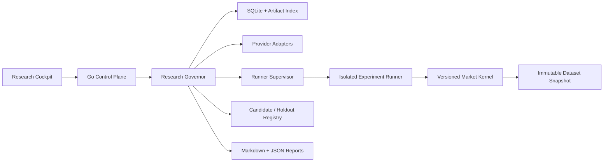

# Asteriade v2.0 基本設計案

作成日: 2026-10-21  
状態: **v2.0 Stage 0開発設計。安全ゲート未達。**

## 1. 基準と実装状態

本書は [現行v2.0要件](REQUIREMENTS.md) の研究特化要件を設計へ写す。ユーザーの条件付き開発指示と[レビュー結果](research/REQUIREMENTS_REVIEW_2026-10-21.md)に基づき、Stage 0から開発を進める。受領Draft 2原本は別途保全する。旧v1.1向け設計は [アーカイブ](archive/v1.1/ARCHITECTURE.md) を参照する。v2への切替後、旧設計の汎用AI開発MVPを現行仕様として参照しない。

Stage 0基盤の実装済み範囲と未達事項は [STAGE0_STATUS.md](STAGE0_STATUS.md) が事実の基準である。既存のGo core/store/API/UIは**legacy substrate**として再利用候補であり、研究機能が実装済みであることを意味しない。研究固有Spec/freeze、研究Run、Python/検証Runner、市場データ、固定検証カーネル、Holdout registryは未実装。現在のRunner能力は閉じられており、Windows実効境界も未検証である。

## 2. 設計原則と推奨構成

| ID | 提案 | 根拠・制約 |
|---|---|---|
| AD-01 | Windows 11 x64、Go Control Plane、埋込Web UI、SQLite。単一 `asteriade.exe` を配布目標とする | Node/npm/Docker/外部DBを起動時必須にしない。Python処理まで単一EXEに収まるとは約束しない（要件 §13.1, §19.7） |
| AD-02 | Control Plane、Research Governor、Storage、Provider Adapter、Experiment Engine/Runnerを契約で分離 | 初期ローカル構成ではGoプロセス内モジュールと、必要に応じた制限付きRunnerプロセス。境界は実機試験で決める |
| AD-03 | Research Governorが状態、予算、同意、試行上限、データpartition、holdout、科学ゲートを強制 | Manager/Reviewerの判断やプロンプトに強制を委ねない |
| AD-04 | StrategySpecと市場/商品別のversioned verification kernelを分離 | Specからkernelの約定、時計、費用、会計、指標を変更できない |
| AD-05 | DBの現在状態に加え、追記イベントと配信outboxを同一トランザクションに保存 | 再起動復旧、候補選抜・Holdout露出の監査、重複要求の識別 |
| AD-06 | 初期研究は暗号資産現物（BTC等）、限定注文表現、合成/参照fixtureから始める | 市場種別は決定済み。venue/feed、時間足、ライセンス、golden vector未確定の間は実市場実験を開始しない |
| AD-07 | 実注文、口座/秘密鍵連携、資金移動を初期製品に実装しない | 要件 §1.3, §13.2。安全設定や承認で後から有効化する設計にも含めない |

推奨トポロジー:



現状の実装は図の一部にあたるローカル管理/API/Store/停止・復旧の基盤だけで、Research Governor・Runner・Kernel・Registryは計画である。外部Provider、実市場データ取得、課金処理、Runner実行は引き続き閉じる。

## 3. 境界と責務

| コンポーネント | 責務 | 境界 |
|---|---|---|
| Research Cockpit / Control Plane | Project設定、現在の研究段階、レビュー、Runner状態、結果、次の工程を表示 | 画面表示を状態の真実源にしない。DB API経由で認可する |
| Research Governor | 有限討論、状態遷移、凍結、claim、上限、予算、candidate/holdout registry、証拠昇格判定 | Managerは機械的安全/科学ゲートを解除できない |
| Provider Adapter | Manager/Reviewerとの会話、独立Session、利用量と外部eventの正規化 | 利用資格・料金・能力不明なら呼び出さない。未承認の有料Providerへ切替えない |
| Experiment Runner | 凍結済み入力を受け、Specを決定的に実行し、成果物・ログ・利用量を返す | 制限された実行identity。DB・秘密・任意ネットワーク・別partitionに触れない |
| Verification Kernel | 市場時刻、データ可視時刻、注文/約定、コスト、position/margin、P&L、指標を計算 | バージョン固定。機能追加は別の科学実装変更、テスト、レビュー、version更新 |
| Dataset Service / Registry | Raw/normalized snapshot、partition、source/license、availability time、選抜・Holdout露出を記録 | 外部データ取得は許可済みsourceだけ。未承認Runner通信の代替として使わない |
| Storage / ArtifactStore | 状態、イベント、hash付きmanifest、成果物参照、backup/restore | 公開Gitに個人投資額、秘密、非公開市場データを保存しない |

市場データ取得のネットワーク経路は未決である。候補は管理側の限定Data Adapterで許可済みsourceだけ取得し、署名/hash付きsnapshotをRunnerへ渡す方式。一般Runnerに任意ネットワークを許可しない。採用方式とsourceはStage 0Cで選定する。

## 4. 研究ドメインと状態

Draft 2 §4.1の中心関係を採用候補とする。

```text
Project → ResearchProgram → Hypothesis → ResearchCycle → Experiment → ExperimentRun
                                      ├─ ReviewIssue / Decision
                                      ├─ StrategySpec revision
                                      ├─ DatasetPartition / SelectionFamily
                                      ├─ BenchmarkDefinition / Evaluation
                                      └─ Artifact / EvidenceRecord / ProspectiveManifest
```

`Project/Task/Execution/Session` は汎用実行履歴に使えるが、上記研究概念へ同一視しない。Runは特定Spec・kernel・data snapshot・partition・code・seed・cost profileの1回の試行である。再実行で同じRunを上書きしない。

状態案（要件の許容値を機械化する段階で再確認）:

| 集約 | 主な状態 |
|---|---|
| Project | `draft / planning / researching / paused / needs_attention / finished / failed / cancelled` |
| ResearchCycle | `hypothesis / first_review / manager_response / rebuttal / decision / experiment_design / preflight / running / validating / interpreting / reported / deferred / rejected / blocked` |
| ExperimentRun | `queued / preparing / running / succeeded / failed / interrupted / outcome_unknown` |
| Evidence class | `exploratory / independent_historical / prospective`。優位性の有無とは別に記録 |
| Holdout partition | `unseen / preflight / evaluation_active / inspected / defect_review / consumed / corrected_analysis / retired`。露出後に未使用へ戻さない |

独立Reviewerは5段階討論のstep 2、必要時step 4のみで、再反論は最大1回。Manager最終判断でもdata leak、kernel欠陥、権限・予算ゲートは解除不可。Reviewerが欠ける場合は承認済み代替か`blocked_review`へ進める。

Pauseは新規claim抑制、interruptは実行中Runnerへの停止要求、cancelは研究サイクル停止として分離する。外部副作用/課金の成否が不明なら`outcome_unknown`にし、自動再送しない。Runの`succeeded`は実験の有効性や戦略の優位性を意味しない。

## 5. Spec freeze、実験同一性、会計kernel

### 5.1 StrategySpecとfreeze manifest

StrategySpecは許可されたSignal/Entry/Exit/Position/Sizing/Risk/Executionの表現、必要データ・availability時刻、変更可能パラメータと制約を構造化する。任意コードを許す場合も、利用可能API・ファイル・環境・ネットワークをRunner側で制限する。kernel実装をSpecからロード/差替えしない。

実験を凍結するときのmanifest案:

`experiment_id, hypothesis_id, protocol_hash, strategy_spec_hash, kernel_id/version/hash, dataset_snapshot_id/hash, partition_roles, benchmark_id/version, cost_profile_id/version, code_sha, parameters/search_space, random_seeds, selection_family_id, acceptance_criteria_hash, provider/model versions, created_at`。

凍結後のどの変更も新revision/Runとして記録する。候補集合と派生元のlineageをResearchProgram横断で保持し、多重選抜の母集団を後から復元できるようにする。Holdout registryはProjectを跨いだ同一期間・銘柄の利用と結果露出を識別する。

**現在は合成fixtureによるSpec/freeze identityの契約と参照試験設計がStage 0Aの対象であり、初期コードは未実装。** 実装着手は親が指定した後続Stage 0作業で行う。

### 5.2 Verification Kernel

kernelは市場/商品別アダプターを持つversioned実装とし、少なくとも入力時刻、バー確定時刻、情報利用可能時刻、注文受付/約定時刻、同一足の曖昧な到達順序、手数料/spread/slippage/funding等、position/cash/margin、強制決済を明示する。標準化したイベント列を用い、同じmanifest・seedで再現可能にする。

Kernelの参照結果は人工データと独立に計算したgolden vectorで照合する。各商品のtick/倍率/セッション等を共通値へ埋め込まない。市場・注文表現・許容差が未選定の間は、一般的な合否値を捏造しない。

## 6. 候補選抜、Benchmark、Prospective

- Hypothesis候補は根拠、反証可能性、データ可用性、費用、情報価値、新規性と既存研究を基に優先順位を説明する。Scoreは成功確率/収益予測と呼ばない。
- 比較用Benchmarkは実験開始前に同一期間・費用・リスク条件を明示して凍結する。適切な比較対象がない場合、相対優位を確認済みとしない。
- 全試行、棄却候補、選抜family、関連Program、データ露出を追記保存。統計補正は仮定適合時のみ使い、サンプル不足を補正済みと表示しない。
- A/B/C比較は同等課題・同データ境界・同じ強制安全/科学ゲート・可能な限り同程度の予算/試行上限を使う。AはManager案のみで診断feedbackを与えず、最終評価時には同じ機械ゲートを適用する。Bは同じ機械診断のfeedbackあり。CはBに独立Reviewerを加える。結果は品質/欠陥検出/費用/時間を記録するだけで、小標本から方式の優劣を結論しない。
- Stage 1はProspective用の凍結manifestと手動記録契約まで。自動観測/自動昇格はStage 2。Stage 1で観測機能が未実装ならCockpitは`pending`を示し、将来証拠があると装わない。

## 7. 保存、移行、配布

現行SQLite migrationのchecksum・過去記録を変更しない。新しいresearch schemaは追加migrationとして導入し、旧Project等を自動でResearchProjectへ読み替えない。Run状態の並行・整合性制約はDB制約とStore transactionで強制する。データ/コード/成果物を別々にhashで識別し、raw market dataをDB本体や公開Gitへ無理に格納しない。

Go Control Plane/静的UI/SQLiteは単一EXEを目標とする。Python backtest engineは次からStage 0で比較する。

| 配布案 | 利点 | 検証事項 |
|---|---|---|
| EXE外の独立Runner/任意セットアップ | 更新・依存の分離 | 利用者にPython必須を課す場合の同意、依存lock/hash、venv権限、Windows sandbox |
| 署名/版固定した同梱Runner | 初回体験が単純 | 配布サイズ、ライセンス、更新、Python/ネイティブ依存、プロセス/ファイル境界 |
| Go/nativeへ再実装 | 配布が単純化する可能性 | 機能/速度/科学的正しさの独立照合と保守費 |

どの方式でも「単一EXEだけでPython研究が動く」と先に約束しない。Data/Runner依存の固定方法、隔離、ログ、seed、停止、再起動後の状態復旧を通してから採用する。

## 8. 現時点で閉じる能力と未解決事項

外部Provider呼び出し、実市場データの取得、従量課金、Runner実行、GitHub自動同期、注文/取引は本設計・Stage 0Aだけでは開始しない。許可済みfixtureを使ったローカル合成試験は可能。

| ID | 未確定/ブロック | 安全側の扱い |
|---|---|---|
| U-01 | v2のStage 0開発基準は採用済み | Stage 0合格とStage 1実行は未達。未決事項は各ゲートで管理 |
| U-02 | 暗号資産現物BTC等を初期市場として選定済み。venue/feed、時間足、データsource/license/availability、保持は未決 | 市場種別以外が決まるまで実データ取得と市場kernel gateを停止。Stage 0Aの合成試験/比較調査は可。Stage 0Cの市場仕様確定作業は開始可能 |
| U-03 | venue/feed/timeframeと初期注文/約定仕様、tie-break、golden vectorと許容差 | 暗号資産現物BTC等は選定済み。これらの仕様が未決定ならStage 0Cの市場kernel gate/Stage 1をblocked |
| U-04 | Python/旧研究/OSSの採否とWindows配布方式 | Stage 0Bで比較、未検証Runnerを実行しない |
| U-05 | Windows sandbox、Codex/Worker/dataのidentity・ネットワーク分離 | Stage 0Dの実証までRunner実行を閉じる |
| U-06 | A/B/C課題割当、予算単位、Reviewer/Provider利用条件 | 方式比較は記録のみ、結論を断定しない。実Provider費用は別途許可 |
| U-07 | Benchmark選択基準、risk policy、統計昇格条件 | Projectごと実験開始前に凍結。不明なら相対優位/証拠昇格なし |
| U-08 | Prospectiveの観測周期・保存期間・昇格条件 | Stage 1は凍結manifest/手動記録のみ、Stage 2で自動化を設計 |

## 9. 参照

- [v2.0 Draft 2](research/inputs/Asteriade_REQUIREMENTS_v2.0_Draft2.md) — 保全した受領原本。整合修正後の開発基準はREQUIREMENTS.md。
- [研究設計提案](research/RESEARCH_DESIGN_PROPOSAL_2026-10-21.md) と [GitHub記録方針](research/GITHUB_RECORDING_POLICY.md) — 提案資料であり要件正本ではない。
- [旧v1.1基本設計](archive/v1.1/ARCHITECTURE.md) — 歴史的参照のみ。
- [Stage 0実装状況](STAGE0_STATUS.md) — 実装済みと未実装の証拠。
