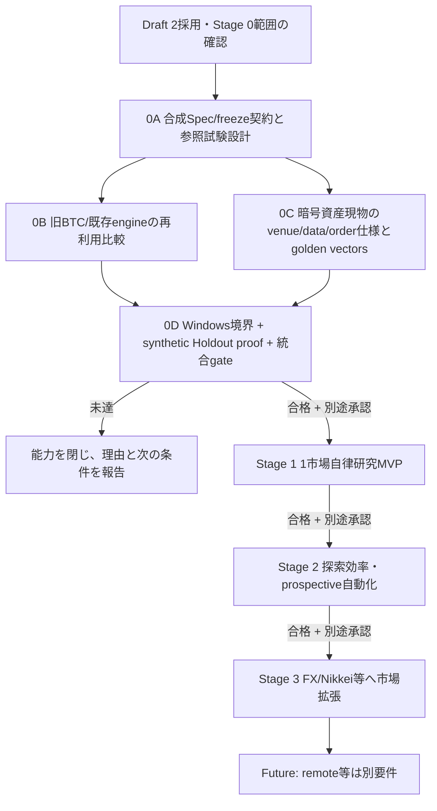

# Asteriade v2.0 段階的実装計画

作成日: 2026-10-21  
状態: **v2.0 Stage 0開発開始。Stage 0安全ゲート未達、Stage 1未着手。**

## 1. 基準と実装済み範囲

本計画は [現行v2.0要件](REQUIREMENTS.md) と[レビュー判断](research/REQUIREMENTS_REVIEW_2026-10-21.md)に基づく。ユーザーの条件付き開発指示によりStage 0から進める。受領Draft 2原本は別途保全する。旧v1.1の実装計画は [アーカイブ](archive/v1.1/IMPLEMENTATION_PLAN.md) を参照する。

既存のProject/Task/Execution、SQLite、event/outbox、冪等性、承認、停止・復旧、loopback UI/APIは旧汎用管理基盤として再利用候補である。最小Spec envelope/freeze identityを独立libraryとして実装した。市場研究の統合機能、market data、研究Runner、固定会計kernel、selection/Holdout registryは未実装。詳細は [STAGE0_STATUS.md](STAGE0_STATUS.md)。DB schema v1とmigration checksumは変更せず、研究schemaは追加migrationとする。既存UI/coreは研究機能があるものとして扱わない。

## 2. 依存順と現在の許可範囲

今回の着手範囲はStage 0に限る。外部Provider呼び出し、従量課金、実市場データ取得、Research/Experiment Runnerの自律実行、GitHub pushは別途許可がない限り閉じる。Windows境界の評価で必要な試験payloadは、管理されたcanary・合成fixtureを使う安全検証であり、AIによる研究実行を有効化するものではない。

初期市場種別はユーザー決定により**暗号資産の現物（BTC等）**。venue/feed、時間足、ライセンス、データ保持、初期注文/約定範囲は未決定。これらが決まるまでStage 0Cの実データ取得・市場kernel合否はblockedとする。合成データによる市場非依存のSpec/freeze試験設計は継続できる。

| Stage | 成果 | 現在の条件/停止範囲 |
|---|---|---|
| 0A | 合成データ上のSpec/freeze identity契約、manifest、参照試験設計 | 最小envelope/freeze libraryを実装。科学/会計の参照試験、DB/Runner統合は未実施 |
| 0B | 旧BTC研究/既存engine/OSSの比較表と再利用判断材料 | 既存資産は未アクセス・未検証。read-only調査と許可済み資料確認に限る |
| 0C | 初期BTC現物の合法データと約定仕様、golden vectors | 市場種別は決定済み。venue/feed/timeframe/license/order semantics選択までは実市場データ使用・合否判定をしない |
| 0D | Windows実効境界、synthetic Holdout proof、Stage 0統合ゲート | 実機未検証。Runnerの研究実行、Provider、外部データ、課金は開けない |
| 1 | 1市場・1仮説の自律研究MVP | Stage 0合格と別途承認後のみ |
| 2 | 選抜対策、探索、Reviewer効果、Prospective自動化/証拠昇格 | Stage 1合格と別途承認後のみ |
| 3 | FX/日経225mini等の市場拡張と長期運用性 | 各市場の独立kernel/data gate後 |
| Future | EC2/remote、実取引可否の再審査 | 新要件・安全審査・ユーザー承認が必要。実注文は現在のDraft2初期範囲外 |

## 3. Stage 0 — 信頼性と方式の実証

### 0A. 合成Spec/freeze契約と参照試験設計（今開始）

対象はmarket-independentなschema/identity契約と合成fixtureのみ。次を設計し、再現可能な参照例を固定する。

- Project/ResearchProgram/Hypothesis/Cycle/Experiment/Runと既存Project/Task/Executionの対応。旧Projectを自動変換しない。
- StrategySpec schema/version/hash、許可component/parameter space、freeze/unfreeze時の新revision、新Run identity。
- `experiment_id, protocol_hash, strategy_spec_hash, kernel_version/hash, dataset_snapshot_id/hash, partition_roles, benchmark_id, cost_profile, code_sha, parameters, seeds, selection_family_id, acceptance_criteria_hash` を持つmanifest契約。
- 同一fixture/Spec/kernel/seedでの再現、未来時刻参照拒否、Run/manifestの改変検知、synthetic Holdout状態遷移の参照試験仕様。
- A/B/Cの比較記録方式: A=Manager案のみ、機械診断を研究中のManagerへ返さない。B=同じ機械診断feedbackを返す。C=B+独立Reviewer。A/B/Cすべて同一の最終安全/科学ゲートを通す。比較結果を貯めるだけで、成績差の結論は出さない。

最小Spec envelope/freeze libraryを実装した。[実装と検証記録](research/STAGE0A_IDENTITY_2026-10-21.md)を参照。残りの契約・参照試験・科学的検証・永続化は未実施。外部データ/Provider/API/課金や実験Runnerは呼ばない。

### 0B. 既存研究/engine再利用比較（未アクセス・未検証）

旧quant-btc-lab、既存検証engine、候補OSSを、許可された範囲でread-only評価する。比較軸はライセンス、対応データ/注文、独立参照計算との一致、未来データ漏洩対策、データ境界、Windows配布依存、性能、保守コスト、改変可能性。評価用データは合成fixtureから始める。現時点で旧BTC研究資産にアクセスした/再利用可能と主張しない。秘密データの複製や外部uploadはしない。

### 0C. 暗号資産現物の市場仕様とgolden vectors（部分blocked）

ユーザーが初期市場を暗号資産現物（BTC等）に選定済み。対象venue/feed、pair、timeframe、データlicense/retention、availability timestamp、初期注文/約定モデル、費用項目・根拠、同一bar順序、許容差は未決定。これらの決定後にだけ、合成/参照データのhand-calculated golden vectorsを確定する。実データ取込前にsource-specificな利用条件と費用を確認する。有料feedの開始には対象と料金上限の許可が必要。

Stage 0Cの合格物は固定fixtureと期待値であり、「市場実運用と同じ」または利益が確認できたという主張ではない。データsourceまたは仕様が未確定なら、この部分をblockedと記録して他のStage 0作業を進める。

### 0D. Windows境界、synthetic Holdout、統合exit（未達）

- Windows 11でControl Plane/Storeと制限Runner候補のidentity、プロセス木、ファイルACL、ネットワーク、秘密分離、停止/復旧を検証する。ユーザーが未選択のvenue/dataへ接続しない。
- 合成datasetでDevelopment/Validation/Final Holdout partition、アクセス記録、consumed/defect review状態、別Project間の再利用防止を実証する。holdout値をProviderへ送らない。
- 現在のlegacy schemaを壊さず追加migrationできること、状態/outbox/backup復旧、Spec/data/code/kernel hashの記録契約を統合確認する。
- Stage 0 exitはWindows実経路の必要な肯定/否定試験、synthetic Holdout proof、固定参照結果、再起動/復旧、データidentityをすべて記録して判定する。Linux tests/cross-build/mockだけではWindows・Runner gateを合格にしない。

未達能力は `blocked / failed / unrun` のまま閉じる。Stage 0で合成基盤が動いてもStage 1は自動承認されない。

## 4. Stage 1 — 1市場の自律研究MVP

着手条件はStage 0 gate合格、現行要件との整合確認、初期venue/data/license/order仕様の固定、公式Providerの現在の利用条件・認証・料金確認、Stage 1の個別承認。Providerが利用不能ならreview/runを捏造せず、許可済み代替またはblocked状態とする。

受入フローは、1市場・1仮説で次を端から端まで追跡する。

`有限5-step討論（独立Reviewer必須）→Manager判断→experiment/spec/benchmark/cost/criteria凍結→Codex検証→Runner backtest→機械評価→結果解釈→Markdown/JSON記録`

合格は研究ループの信頼できる完走であり、収益戦略の発見ではない。否定結果、全候補、棄却理由、費用、benchmark、既知欠陥と再現性を保存する。人が毎回「続けて」と言わなくても許可範囲の有限loopを進め、予算・時間・回数上限で停止する。強制ゲートはAI判断で緩和しない。

A/B/Cの意味を全方式で固定する: AはManager案のみで機械診断を研究中の判断へfeedbackしない、Bは同じ機械診断feedbackあり、CはBに独立Reviewerを加える。安全/科学ゲート、データ境界、最終評価は同一。課題・seed・期間・予算差を記録し、サンプル不足時は優劣を結論しない。

ProspectiveはStage 1でStrategySpec/kernel/data-feed identityを凍結したmanifestと手動記録契約までを優先する。自動観測が未実装ならCockpitで`pending`と表示する。自動signal観測と証拠クラス昇格はStage 2。

## 5. Stage 2 — 研究効率・選抜対策・Prospective

着手はStage 1の合格と別途承認後。Research memory/仮説lineage、ResearchProgram横断selection family、Grid/Random/GA、Reviewer効果測定、自動prospective signal capture、evidence-class promotionを段階導入する。Holdout registryが別Project間のデータ利用と結果露出を追跡する。統計手法は前提が満たされる場合のみ使い、前提不成立を「補正済み」と表示しない。実料金が発生する試験は個別の対象・上限を決める。

## 6. Stage 3 — 市場拡張と運用

暗号資産現物のStage 0/1品質を基準に、各市場の独立kernel/data/license/reference fixtureを追加する。候補はFXと日経225mini。商品仕様、session、contract/tick/multiplier、funding/swap、rolloverなどを個別に検証し、暗号資産のルールを流用しない。長期データ保全、レポート検索、GitHub引継ぎUXを完成させる。外部書込みは対象と公開先の明示承認が必要。

## 7. Futureと対象外

EC2、スマホremote access、cloud DB、実取引、口座接続、資金移動は現在のStageに含めない。実取引を検討する場合も新たな要件・法務/安全審査・明示承認が必要で、既存のStage gateを拡張解釈しない。

## 8. 要件受け入れ確認の対応

以下の製品AT全体は未完了。現行要件 AT-01〜42を各Stageへ割当て、試験証跡を [STAGE0_STATUS.md](STAGE0_STATUS.md) またはStageごとのreportに記録する。

| Stage | 主なAT | 主な合格証拠 |
|---|---|---|
| 0A | AT-10/13/14/15/19/25/29/30/38 | 合成Spec/freeze、参照約定・会計、リーク/欠陥検出の契約とfixture |
| 0B | AT-39 | 旧BTC/OSS再利用比較、未確認点と採否根拠 |
| 0C | AT-10/11/27/29 | venue/data/order仕様に結び付いたgolden fill/fee/P&L vectors。仕様未決はblocked |
| 0D | AT-01/07/13/14/16/25/26/37 | Windows境界、holdout registryのsynthetic proof、状態復旧。未達能力は閉鎖 |
| 1 | AT-01〜12, 15〜26, 28〜36, 38/40（市場固有ATは固定した1市場のみ） | 有限討論・1仮説E2E・benchmark・全候補/否定結果/レポート・同一gateのA/B/C記録 |
| 2 | AT-09/19/31/32/35/36/37 | 研究横断のselection history、GA/Prospective自動記録、評価前提と費用の監査 |
| 3 | AT-27/39ほか市場固有ケース | 各追加市場の独立kernel/data/contract tests |

AT対応は導入段階の計画で、各試験の実測結果を別記する。future-only ATを現在の合格と数えない。AT-41/42（注文能力なし・非公開情報送信拒否）はStage 0/1の境界試験へ追加する。

## 9. Stage 0開始前・継続中の条件

1. 要件レビューと整合修正を完了し、ユーザー依頼に基づいてStage 0開発基準を採用した。受領原本の状態を過去の記録として保全する。
2. 初期市場種別は暗号資産現物BTC等に決定済み。venue/feed/timeframe/license/order/fill semanticsは未決で、Stage 0Cの実データ・市場kernel合否は停止中。
3. 旧BTC資産/既存engineの利用可否は未検証。比較調査の対象アクセス権、データの秘匿範囲を確認する。
4. Windows実機のSandbox、Worker identity、Holdout境界の試験は未達。標準ユーザー作業、管理者変更、外部接続は個別に範囲を定める。
5. Python/Runner配布方式と公式Providerの利用条件・料金は未確定。外部Provider、データ取得、追加課金、AI-driven Runner実行は閉じる。
6. 実験データや個人の投資額、口座・認証情報、秘密研究データをpublic docs/GitHubへ含めない。今回のソース/設計/添付の専用ブランチへのPushはユーザー依頼済み。将来の研究結果の公開や既定ブランチへのマージは別の範囲。

Stage 0作業の報告では、設計、実装済みコード、Linux/mock試験、Windows実機試験、外部Provider実行を区別する。Stage 0 gate合格とStage 1開始は別判断である。
