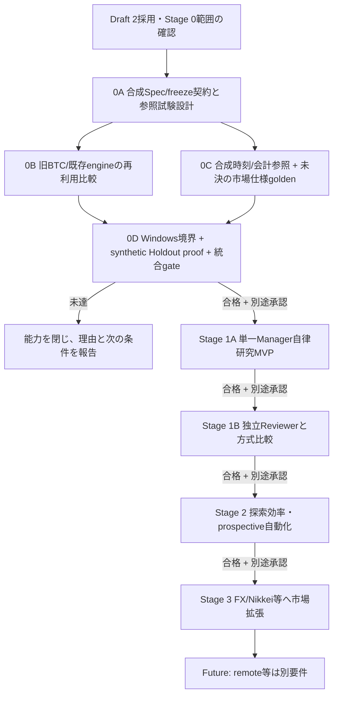

# Asteriade v2.0 段階的実装計画

作成日: 2026-10-21  
状態: **Stage 0Cの小規模合成検証を追加する作業ブランチ。Stage 0全体の安全/科学ゲート未達、Stage 1A/1B未着手。**

## 1. 基準と実装済み範囲

本計画は [現行v2.0要件](REQUIREMENTS.md)、[レビュー判断](research/REQUIREMENTS_REVIEW_2026-10-21.md)、[PR #2を踏まえた段階化案](research/MVP_SCOPE_REVISION_2026-10-21.md)に基づく。ユーザーの条件付き開発指示によりStage 0から進める。受領Draft 2原本は別途保全する。旧v1.1の実装計画は [アーカイブ](archive/v1.1/IMPLEMENTATION_PLAN.md) を参照する。

既存のProject/Task/Execution、SQLite、event/outbox、冪等性、承認、停止・復旧、loopback UI/APIは旧汎用管理基盤として再利用候補である。最小Spec envelope/freeze identityを独立libraryとして実装した。市場研究の統合機能、market data、研究Runner、製品会計kernel、selection/Holdout registryは未実装。今回のPython標準ライブラリ参照例は製品Runnerではなく、既存Go基盤を変更しない。詳細は [STAGE0_STATUS.md](STAGE0_STATUS.md)。DB schema v1とmigration checksumは変更せず、研究schemaは追加migrationとする。既存UI/coreは研究機能があるものとして扱わない。

## 2. 依存順と現在の許可範囲

今回の許可範囲はMVP段階化の設計更新とStage 0Cの小規模合成検証、専用ブランチへのPush/レビュー用PR作成まで。PR #2は参照のみでマージ・クローズしない。masterへマージしない。外部Provider呼び出し、従量課金、実市場データ取得、Research/Experiment Runnerの自律実行、GitHub pushは別途許可がない限り閉じる。Windows境界の評価で必要な試験payloadは、管理されたcanary・合成fixtureを使う安全検証であり、AIによる研究実行を有効化するものではない。

初期市場種別はユーザー決定により**暗号資産の現物（BTC等）**。venue/feed、時間足、ライセンス、データ保持、初期注文/約定範囲は未決定。これらが決まるまでStage 0Cの実データ取得・市場kernel合否はblockedとする。市場仕様とは独立した合成fixtureの時刻・会計・失敗検査は今回実装する。合成値を未決の市場仕様の代用にしない。

| Stage | 成果 | 現在の条件/停止範囲 |
|---|---|---|
| 0A | 合成データ上のSpec/freeze identity契約、manifest、参照試験設計 | 最小envelope/freeze libraryを実装。当時の科学/会計参照試験は未実施。今回0Cで独立toy単位を追加、DB/Runner統合は未実施 |
| 0B | 旧BTC研究/既存engine/OSSの比較表と再利用判断材料 | 調査・設計判断を完了。[比較報告](research/STAGE0B_REUSE_EVALUATION_2026-10-21.md)。コード移植、同条件の実行比較、Windows配布は未実施 |
| 0C | 小規模合成時刻/会計/曖昧性検査 ＋ 初期現物の市場仕様golden | 合成参照例を追加。venue/feed/timeframe/license/order semantics未決の市場部分はblocked。実データは使用しない |
| 0D | Windows実効境界、synthetic Holdout proof、Stage 0統合ゲート | 実機未検証。Runnerの研究実行、Provider、外部データ、課金は開けない |
| 1A | 単一Manager＋機械ゲート、現物1市場・1仮説の自律研究MVP | Stage 0合格と別途承認後のみ |
| 1B | 独立Reviewer・有限討論・1Aとの品質/費用/時間比較 | 1A完走レビューと別途承認後のみ |
| 2 | 選抜対策、探索、比較評価高度化、Prospective自動化/証拠昇格 | Stage 1合格と別途承認後のみ |
| 3 | FX/日経225mini等の市場拡張と長期運用性 | 各市場の独立kernel/data gate後 |
| Future | EC2/remote、実取引可否の再審査 | 新要件・安全審査・ユーザー承認が必要。実注文は現在のDraft2初期範囲外 |

## 3. Stage 0 — 信頼性と方式の実証

### 0A. 合成Spec/freeze契約と参照試験設計（最小identity実装済み）

対象はmarket-independentなschema/identity契約と合成fixtureのみ。次を設計し、再現可能な参照例を固定する。

- Project/ResearchProgram/Hypothesis/Cycle/Experiment/Runと既存Project/Task/Executionの対応。旧Projectを自動変換しない。
- StrategySpec schema/version/hash、許可component/parameter space、freeze/unfreeze時の新revision、新Run identity。
- `experiment_id, protocol_hash, strategy_spec_hash, kernel_version/hash, dataset_snapshot_id/hash, partition_roles, benchmark_id, cost_profile, code_sha, parameters, seeds, selection_family_id, acceptance_criteria_hash` を持つmanifest契約。
- 同一fixture/Spec/kernel/seedでの再現、未来時刻参照拒否、Run/manifestの改変検知、synthetic Holdout状態遷移の参照試験仕様。
- A/B/Cの比較記録方式: A=Manager案のみ、機械診断を研究中のManagerへ返さない。B=同じ機械診断feedbackを返す。C=B+独立Reviewer。A/B/Cすべて同一の最終安全/科学ゲートを通す。比較結果を貯めるだけで、成績差の結論は出さない。

最小Spec envelope/freeze libraryを実装した。[実装と検証記録](research/STAGE0A_IDENTITY_2026-10-21.md)を参照。残りの契約・参照試験・科学的検証・永続化は未実施。外部データ/Provider/API/課金や実験Runnerは呼ばない。

### 0B. 既存研究/engine再利用比較（調査・設計判断を完了）

旧quant-btc-lab、既存検証engine、候補OSSを、許可された範囲でread-only評価する。比較軸はライセンス、対応データ/注文、独立参照計算との一致、未来データ漏洩対策、データ境界、Windows配布依存、性能、保守コスト、改変可能性。評価用データは合成fixtureから始める。2026-10-21にquant-btc-labの固定ソースとFreqtrade/Backtraderを調査し、部品分類、主要不具合と修正、独立正解試験、Stage 0C未決事項を記録した。旧実データ/数値artifactを取得せず、秘密データの複製や外部uploadも行っていない。結果は[比較報告](research/STAGE0B_REUSE_EVALUATION_2026-10-21.md)と[AI向け引き継ぎ](research/STAGE0B_HANDOFF.md)を参照。同条件のengine実行比較、ライセンス適合、Windows配布の実証は未完了で、AT-39やStage 0全体の全面合格を意味しない。

### 0C. 小規模合成検証と市場固有golden（市場部分はblocked）

**今回の増分：** Python 3.12標準ライブラリだけで、`reference/asteriade_synthetic`に小さな独立参照例、`reference/tests`に固定期待値・独立計算の正解テストを置く。旧コードやOSSは移植しない。アプリ起動にPythonを要求せず、製品Runnerの言語・配布方式も確定しない。StrategySpec/freezeを改変せず、戦略生成コードを会計/時刻カーネルへ混ぜない。

- 足開始/終了、公開、受領、シグナル、約定可能/約定時刻を分離。受領前の判断や早過ぎる約定を拒否する。
- 仮想quote単位のlong-only現物について現金・数量・手数料・平均取得原価・部分売却・実現/評価損益・評価資産・DDを検査する。
- 固定小数文字列と有理数演算を使い、手計算の固定値と別実装のDecimal期待値で照合。未来情報、現金/在庫不足、二重約定、OHLCのstop/target同時touchは拒否し、失敗時に状態を変えない。
- 完了条件は再現可能なコマンド、全toy testの成功、Go基盤の回帰確認、仕様・限界・実測を記した[検証記録](research/STAGE0C_SYNTHETIC_VALIDATION_2026-10-21.md)。製品AT・市場kernel・Windowsゲートを全面合格にしない。

**市場固有部分：** venue/feed、pair、timeframe、license/retention、availability根拠、注文方式、費用・tick/lot/丸め、同一bar順序、許容差は未決。仕様と権利を確定してから、そのprofileのgolden vectorsを別途定義・実測する。合成会計にはこれらを仮定して埋め込まない。実データ取得・有料feed開始は今回対象外。

### 0D. Windows境界、synthetic Holdout、統合exit（未達）

- Windows 11でControl Plane/Storeと制限Runner候補のidentity、プロセス木、ファイルACL、ネットワーク、秘密分離、停止/復旧を検証する。ユーザーが未選択のvenue/dataへ接続しない。
- 合成datasetでDevelopment/Validation/Final Holdout partition、アクセス記録、consumed/defect review状態、別Project間の再利用防止を実証する。holdout値をProviderへ送らない。
- 現在のlegacy schemaを壊さず追加migrationできること、状態/outbox/backup復旧、Spec/data/code/kernel hashの記録契約を統合確認する。
- Stage 0 exitはWindows実経路の必要な肯定/否定試験、synthetic Holdout proof、固定参照結果、再起動/復旧、データidentityをすべて記録して判定する。Linux tests/cross-build/mockだけではWindows・Runner gateを合格にしない。

未達能力は `blocked / failed / unrun` のまま閉じる。Stage 0で合成基盤が動いてもStage 1は自動承認されない。

## 4. Stage 1A / 1B — 順序を分けた自律研究MVP

共通着手条件はStage 0 gate合格（Windows実効境界を含む）、現行要件との整合、初期venue/data/license/order仕様と採用engineの独立正解確認、公式Providerの利用条件・認証・料金、当該Stageの個別承認。今回これらの実装・有効化へは進まない。

### 1A. 単一Manager＋機械品質ゲート

`仮説生成 → Manager計画 → experiment/spec/benchmark/cost/criteria凍結 → 事前テスト → backtest → 機械評価 → Manager解釈 → Markdown/JSON・Market Knowledge保存`

対象は暗号資産現物1市場、1仮説から始める。旧資産の検証済み部分再利用を優先し、汎用engine新作を前提にしない。人の逐次指示を要さず、許可された有限loopを予算・時間・回数上限内で進める。失敗・無効・権限/料金不明時は有限停止し、Managerも強制ゲートを上書きできない。Reviewerは`not_enabled_stage1a`と明示する。

最小Cockpitは現在の仮説・フェーズ・次工程・停止理由・結果参照を表示する。現行UIを全面改修しない。否定結果、全候補、棄却理由、費用、事前baseline、再現性、Market Knowledgeを保存する。完走はソフトウェアの信頼性の条件で、利益発見は条件にしない。[代表12縦断ケース](research/MVP_SCOPE_REVISION_2026-10-21.md)を入口とし、該当する安全・科学ATをすべて確認する。

Prospectiveは凍結manifestと将来観測の手動記録契約までを維持する。未観測は`pending`。自動観測・昇格はStage 2。知識検索UI/DB、専門Reviewer群、並列Runner、大規模GAは先送りする。

### 1B. 独立Reviewerと限定比較

1A完走レビュー後、別途許可で計画凍結前に5-step討論を追加する。Manager提示→Reviewer反論→Manager採否/根拠→必要なら1回再反論→Manager最終判断。Reviewer発言機会は最大2回、割当済みReviewerが利用不能なら許可済み代替または`blocked_review`で停止する。

1AのB方式（単一Manager＋機械診断feedback）と、Bに独立Reviewerを加えたC方式を、同じ課題・データ境界・強制ゲート・費用/時間条件で比較する。A（助言feedbackなし、最終ゲート共通）は追加比較条件で、1Aの完了条件にしない。AT-03/04/05/35、品質・欠陥検出・費用・時間を記録し、小標本や条件差で不明なら不明とする。討論を追加するだけで改善済みとは判定しない。高度な評価はStage 2。

1A初回完走と数サイクル後、1B比較後に、無効Run率、手動対応時間、費用、研究記録の再利用価値を確認する。便益不足なら機能を増やす前に範囲や方式を見直す。科学・安全ゲートを弱める撤退策は採らない。

## 5. Stage 2 — 研究効率・選抜対策・Prospective

着手はStage 1A/1Bのレビューと別途承認後。Research memory/仮説lineage、ResearchProgram横断selection family、Grid/Random/GA、Reviewer効果測定、自動prospective signal capture、evidence-class promotionを段階導入する。Holdout registryが別Project間のデータ利用と結果露出を追跡する。統計手法は前提が満たされる場合のみ使い、前提不成立を「補正済み」と表示しない。実料金が発生する試験は個別の対象・上限を決める。

## 6. Stage 3 — 市場拡張と運用

暗号資産現物のStage 0/1品質を基準に、各市場の独立kernel/data/license/reference fixtureを追加する。候補はFXと日経225mini。商品仕様、session、contract/tick/multiplier、funding/swap、rolloverなどを個別に検証し、暗号資産のルールを流用しない。長期データ保全、レポート検索、GitHub引継ぎUXを完成させる。外部書込みは対象と公開先の明示承認が必要。

## 7. Futureと対象外

EC2、スマホremote access、cloud DB、実取引、口座接続、資金移動は現在のStageに含めない。実取引を検討する場合も新たな要件・法務/安全審査・明示承認が必要で、既存のStage gateを拡張解釈しない。

## 8. 要件受け入れ確認の対応

以下の製品AT全体は未完了。現行要件 AT-01〜42を各Stageへ割当て、試験証跡を [STAGE0_STATUS.md](STAGE0_STATUS.md) またはStageごとのreportに記録する。

| Stage | 主なAT | 主な合格証拠 |
|---|---|---|
| 0A | AT-10/13/14/15/19/25/29/30/38 | 合成Spec/freeze、参照約定・会計、リーク/欠陥検出の契約とfixture |
| 0B | AT-39 | 旧BTC/OSS再利用比較、未確認点と採否根拠 |
| 0C | AT-07/10/11/27/29/30の部分根拠 | 今回は合成時刻・会計・拒否試験のみ。市場profileのgoldenは未決、製品AT全面合格ではない |
| 0D | AT-01/07/13/14/16/25/26/37 | Windows境界、holdout registryのsynthetic proof、状態復旧。未達能力は閉鎖 |
| 1A | AT-01/02/06/07/10〜26/28〜34/36〜38/40〜42（初期1市場の契約） | 単一Manager E2E、全機械ゲート、benchmark、全候補/否定結果、Markdown/JSON/MK、停止/回復 |
| 1B | AT-03/04/05/17/35 | 有限討論とManager回答/決定、B対Cの品質・欠陥検出・費用・時間比較 |
| 2 | AT-08/09/19/31/32/35/36/37の強化 | 研究横断のselection history、GA/Prospective自動記録、評価前提と費用の監査 |
| 3 | AT-27/39ほか市場固有ケース | 各追加市場の独立kernel/data/contract tests |

AT対応は導入段階の計画で、各試験の実測結果を別記する。future-only ATを現在の合格と数えない。AT-41/42（注文能力なし・非公開情報送信拒否）はStage 0/1の境界試験へ追加する。

## 9. Stage 0開始前・継続中の条件

1. 要件レビューと整合修正を完了し、ユーザー依頼に基づいてStage 0開発基準を採用した。受領原本の状態を過去の記録として保全する。
2. 初期市場種別は暗号資産現物BTC等に決定済み。venue/feed/timeframe/license/order/fill semanticsは未決で、Stage 0Cの実データ・市場kernel合否は停止中。
3. Stage 0Bのソース調査・設計比較は完了。旧BTC資産の部分再利用は権利/境界/golden確認待ち、Freqtradeは初期ランタイム非採用、Backtraderは独立比較器の予備候補。engine実測・Windows配布・ライセンス適合は未検証。
4. Windows実機のSandbox、Worker identity、Holdout境界の試験は未達。標準ユーザー作業、管理者変更、外部接続は個別に範囲を定める。
5. Python/Runner配布方式と公式Providerの利用条件・料金は未確定。外部Provider、データ取得、追加課金、AI-driven Runner実行は閉じる。
6. 実験データや個人の投資額、口座・認証情報、秘密研究データをpublic docs/GitHubへ含めない。今回のソース/設計/添付の専用ブランチへのPushはユーザー依頼済み。将来の研究結果の公開や既定ブランチへのマージは別の範囲。

Stage 0作業の報告では、設計、実装済みコード、Linux/mock試験、Windows実機試験、外部Provider実行を区別する。Stage 0 gate合格とStage 1開始は別判断である。
