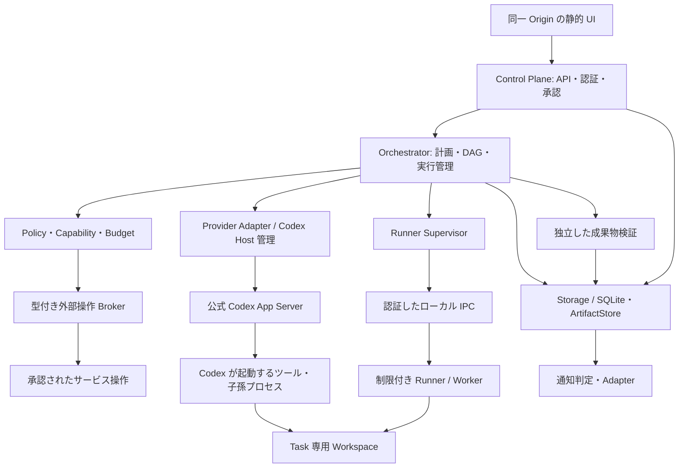

# Asteriade 基本設計案

作成日: 2026-10-20（Asia/Tokyo）  
状態: 設計基準。Stage 0 開始承認済み、Windows 実機検証は未実施。実装差分と制約は STAGE0_STATUS.md に記録。

## 1. 入力と設計の位置付け

入力は、元コミット `8b55314cb6e5ea655400b9fb46dfa00eee8964bc` の要件定義書 v1.1 全文と [AGENTS.md](../AGENTS.md)、ユーザーの指示である。2026-10-20 のユーザー承認により、既存 v1.1 を内容を変えず [正式要件 docs/REQUIREMENTS.md](REQUIREMENTS.md) へ配置し、Stage 0 の基盤実装を開始した。U-01 は解決済み。最新の実装と未達ゲートは [STAGE0_STATUS.md](STAGE0_STATUS.md) を参照する。

本書は実装する契約の提案であり、API・DB・OS 設定が既に存在することを意味しない。要件を増減する判断と未検証の技術仮説は区別する。特に要件 §18 の技術ゲートは未達であり、その解消のための仮設計として読む。実装順と承認境界は [実装計画](IMPLEMENTATION_PLAN.md)、実機での合否条件は [セキュリティ検証計画](SECURITY_VALIDATION.md) に定める。

AT-01〜26 の設計箇所・導入 Stage・検証 ID の対応は、実装計画 §8 に全件記載する。現在の設計レビューを、それらの実測合格とは扱わない。

## 2. スコープと判断

| ID | 設計案 | 理由・採用条件 |
|---|---|---|
| AD-01 | Windows 11 x64、Go、静的 UI 埋め込み、SQLite WAL、単一 `asteriade.exe` | 要件 §4。Node.js/npm/Docker/外部 DB は実行時に不要。Codex CLI・Edge 等は診断で案内する外部前提 |
| AD-02 | Control Plane と Orchestrator は同一プロセスの別モジュール。Runner は同じ EXE の内部モードで別プロセス化 | 最小の配布単位を維持し、実行側の権限・寿命を分離する。別プロセス化自体は安全性の証明ではない |
| AD-03 | 任意ツール実行は Windows の検証済み境界内だけで許す | 承認 UI・プロンプト・モデルの判断を強制境界にしない。OS と Codex の組合せが不成立なら当該能力を無効化 |
| AD-04 | 現在状態を DB に保存し、監査イベントと配送用 outbox を同一トランザクションで追記 | 全面的なイベントソーシングは採用しない。更新の原子性と再取得を確保 |
| AD-05 | Task、Execution、Session の ID と寿命を分離 | 再試行、モデル変更、停止・復旧時に仕事と試行と会話を混同しない |
| AD-06 | Stage 1 は Codex 単独、1 親 Agent。Stage 2 で複数 Agent と Bedrock を追加 | MVP を実用的な小規模開発タスクに絞る。安全境界・承認・検証は MVP 前から必須 |
| AD-07 | 成否不明の外部操作は照会・人の確認へ進め、自動再送しない | ローカルの冪等キーだけでは外部サービスの exactly-once を保証できない |
| AD-08 | クラウド・モバイルは契約だけを維持 | EC2、リモート認証の実装、PWA、Push 配信、外部公開を初期版に含めない |

同一プロセスだけの構成は単純だが、自由な CLI と管理側データの分離が弱い。最初から複数サービス・クラウド DB に分割する構成は配布・認証・運用の負担が大きい。AD-02 を推奨するが、Windows の実測で成立する起動・認証経路を確認してから具体方式を固定する。

## 3. コンポーネントと信頼境界

図の Codex Host と Worker の権限関係は Stage 0 の検証対象である。App Server のツール実行が必ず Asteriade の Broker を経由するとは仮定しない。Codex が直接起動する子孫プロセスも同じ検証対象に含める。

| 境界 | 責務と禁止事項 |
|---|---|
| Control Plane | UI 認証、Project/Plan/Instruction/Approval API、整合した状態表示。モデルに DB 更新権限を渡さない |
| Orchestrator | DAG、上限、計画版、claim、追加指示、検証と復旧を調整。モデル出力を検証せずコマンドに変換しない |
| Policy / Capability | 操作の意味、対象、検証済み能力、権限版を評価。不明・期限切れ・構成変更なら拒否 |
| Runner Supervisor | 検証済みプロファイルで起動、Job/プロセス木の管理、IPC、作業領域の割当て。モデルが自由に呼べる汎用の権限昇格サービスにしない |
| Worker / ツール子孫 | Task の許可範囲内で作業。管理 DB、Control Plane の認証情報、他 Task の Workspace、通知送信資格情報にアクセスさせない |
| Provider Adapter | モデル会話・公式認証・イベントを正規化。Provider 固有 ID とドメイン ID を対応付ける。Runner の OS 制約を無効化しない |
| 外部操作 Broker | 宛先・アカウント・本文等を固定した型付き操作のみ実施。承認と予算を再検証。任意 URL/任意シェルを特権付きで代理実行しない |
| Verifier | 計画に固定した検証条件で成果物を確認。テストも任意コードなので、検証済み Runner 内で実行 |
| Storage / ArtifactStore | トランザクション、マイグレーション、バックアップ、成果物の内容ハッシュ。秘密本体をログや通常 DB に格納しない |
| Notification | 親 Project の完了・質問・承認・予算・重大停止だけ通知。子孫の通常イベントを通知に昇格しない |

Runner 用 IPC は候補として Windows Named Pipe を使用し、アクセス ACL、相手の identity、起動ごとの秘密、Execution と権限版の束縛を検証する。起動引数で内部モードを指定できることを認可の代わりにしない。プロトコルはサイズ上限・型検証・再送 ID を持ち、モデル指定の実行ファイルを管理側の権限で起動しない。

Broker は許可された操作ごとに、固定したサービス/アカウント、TLS宛先、method、入力schema/本文hash/サイズ、応答上限を制約する。redirect は拒否するか遷移先を毎回再検証し、DNS変更や別宛先へ資格情報を転送しない。汎用HTTP proxy・URL fetch・特権shellとして使えないことを否定試験する。Hostのモデル通信許可が子孫ツールへ漏れるなら、このBrokerがあっても送信境界は未達である。

Codex Host は公式認証に必要な資格情報を扱う信頼済みコンポーネントであり、モデルが生成したコマンドとは信頼レベルが違う。Host の認証プロファイルをツール用の identity から保護できるか、公式 Windows sandbox と追加 OS 制約でファイル・通信・プロセスの境界が両立するかは U-03/U-04 で実証する。認証ファイルの単純コピーや、全子プロセスへの秘密環境変数継承で解決しない。成立しなければ Codex の無人ツール実行を開放しない。

## 4. 配布、データ配置、Workspace

本体は `go:embed` による静的 UI を含む EXE とする案。SQLite driver は pure Go と CGO/static link の候補を比較し、Windows x64 の単一 EXE、ライセンス、WAL、バックアップ API、ビルド再現性を満たすものを Stage 0 で選ぶ。ライブラリと Go/Codex の版は検証後に固定し、現段階では依存を追加しない。

通常ユーザー向けデータ配置案は `%LOCALAPPDATA%\Asteriade\` 配下の `db/`、`artifacts/`、`logs/`、`backups/`、`runner-profiles/`。秘密は Windows の保護された資格情報保管に分離する。Worker 用 Workspace は専用 ACL を適用する別領域とし、ユーザーの任意パスをそのまま信頼しない。成果物・DB は生成データなので、EXE 単体配布とは矛盾しない。

アプリ本体は標準ユーザーで実行し、管理者権限を常用しない。別ユーザー作成・Firewall/WFP 設定等で管理者操作が必要なら、内容を示して Stage 0 の実験前に許可を得る。常駐する自作特権サービスを暗黙の前提にしない。

製品の Task Workspace は TaskID と base revision を持つ。Stage 1 は単一 Task の独立ディレクトリで開始し、Stage 2 で Git worktree 等を比較する。統合前に基準版・差分・テスト・競合を確認し、自動上書きしない。本セッションの Codex 作業は既存の隔離されたチェックアウトを使い、新たな Git worktree は作らない。製品内の将来機能と今回の開発環境を区別する。

## 5. ドメインと状態契約

### 5.1 ID、版、完了条件

ID は衝突しない不透明な文字列とし、Task に PID や絶対パスを埋め込まない。Agent は論理的な担当、Task は仕事、Execution は一回の試行、Session は Provider/接続/モデルに固有の文脈である。Provider の thread/turn ID は別列に保存する。再試行は同じ Task に新しい Execution を作り、互換性のないモデル・接続への切替は新 Session とする。

Plan の改訂は追記し、Execution は開始時の plan revision、policy revision、acceptance spec hash、Runner profile fingerprint に固定する。旧計画の実行結果を新計画の達成と自動解釈しない。完了条件は Orchestrator が依頼から構造化して提示し、計画確認モードではユーザー確認後に固定する。自動モードでも既に許可された範囲の検証条件だけを採用し、外部操作・費用・権限拡大は別承認とする。モデルが完了条件やテストを緩和した場合は計画改訂として再評価する。

### 5.2 Task 遷移

| 現在 | 許可する次状態 | 条件 |
|---|---|---|
| queued | ready / cancelled / failed | 依存が0件、または全依存 Task が検証済み完了なら ready。循環・不正な計画は登録時点で拒否 |
| ready | running / awaiting_approval / awaiting_answer / cancelled / failed | 実行前条件を満たす場合だけ Execution を原子的に claim |
| running | awaiting_approval / awaiting_answer / verifying / failed / cancelled / recovery_required | 実行中の承認待ちでも Execution と tool operation の状態を別に保持 |
| awaiting_approval / awaiting_answer | ready / running / failed / cancelled / recovery_required | 実行中断点が有効なら running、再起動が必要なら ready。必要条件を全て再検証 |
| verifying | completed / failed / cancelled / recovery_required | 全必須検証に合格した場合だけ completed |
| failed | ready / cancelled | 安全な再試行条件と上限を満たす場合だけ新 Execution |
| recovery_required | verifying / ready / failed / cancelled | 外部副作用と残存プロセスを照合。成否未解決のまま ready にしない |
| completed / cancelled | なし | 追加修正は新 Task または計画改訂で追跡し、確定済み結果を改ざんしない |

表中の cancelled への遷移は、生存試行が終了確認済みで、外部副作用に未解決結果がない場合に限る。取消要求は先に `cancel_requested_at` と停止理由を保存し、新規開始を抑制する。終了確認までは元の状態に「取消要求中」を付けて表示し、不明な結果があれば recovery_required とする。取消が確定済みの Task をモデルの成功回答で completed に変更しない。先に completed が確定していた場合、取消要求は競合または変更なしとして返す。

実行途中の awaiting_approval/awaiting_answer は、Provider が checkpoint で停止していることを確認した場合だけ同じ Execution=running を維持できる。確認できなければ中断し、終了/副作用を照合してから新 Execution に進む。承認待ち中に別コマンドが動き続ける経路を許さず、再開時には他の待機条件も全て解消済みか検査する。

### 5.3 Execution、Project、停止

Execution の許可遷移は `starting → running / failed / interrupt_requested / outcome_unknown`、`running → succeeded / failed / interrupt_requested / outcome_unknown`、`interrupt_requested → interrupted / succeeded / failed / outcome_unknown`。`succeeded / failed / interrupted` は確定した試行結果、`outcome_unknown` は照合待ちである。照合後の `outcome_unknown → succeeded / failed / interrupted` は根拠付きの復旧操作に限定する。再実行で既存の Execution を `running` に戻さない。

Project は lifecycle と scheduler の抑制理由を分けて保存し、API の status を投影する。lifecycle の許可遷移は以下に限定する。

| lifecycle | 許可する次状態 | 条件 |
|---|---|---|
| draft | planning / cancelled | 目標・計画の開始、または未実行の取消 |
| planning | running / needs_attention / failed / cancelled | 計画確認を含む全前提が揃ってから running |
| running | completed / needs_attention / failed / cancelled | 全必須 Phase・最終成果物検証が揃った場合だけ completed |
| needs_attention | planning / running / failed / cancelled | 質問/承認/復旧等の必要条件が解消され、現在版を再検証 |
| failed | planning / cancelled | 明示的な復旧・再計画。旧試行を上書きしない |
| completed | planning | ユーザーの追加修正で新しい計画版・Taskを作る場合だけ。旧成果と受諾履歴を保持 |
| cancelled | なし | 再依頼は新 Project として追跡 |

cancelled への確定は Task と同じ終了・結果照合条件を要する。API の status は、active な停止holdがあり lifecycle がplanning/runningの場合に paused、それ以外は lifecycle とする。重大な復旧待ち等の needs_attention は pause で隠さない。scheduler は hold と lifecycle の両方を評価する。Project 完了とユーザー受諾は別で、受諾を計画版に束縛し、改訂で旧受諾を新成果へ流用しない。

| 操作 | 実行時の効果 |
|---|---|
| 一時停止 | scheduler_holds に全体/Project別の理由・主体付き hold を保存し、新しい claim を止める。既存 Execution は原則継続し安全な区切りで止める |
| 即時停止 | Provider に中断要求し、猶予後に管理しているプロセス木を止める。外部操作の巻き戻しは保証せず、不明な結果は outcome_unknown |
| キャンセル | 新規実行・自動再試行を止め、進行中には中断を要求。終了確認前は cancelling 相当の表示を派生し、事実と希望を分ける |
| 再開 | 権限、計画版、認証、予算、外部結果、Worker 生存を再確認。新試行なら必ず新 Execution |

Task の `paused` 状態は作らない。抑制の唯一の根拠は scheduler_holds とし、全体/Project/安全停止の複数holdを合成する。Project再開では全体holdや安全停止holdを解除せず、各holdの権限を持つ主体だけが解除できる。cancel_requestedも独立に新規開始を止め、hold解除で取消要求を取り消さない。

時計は3種類を区別する。Execution実稼働はProvider/Workerが実際に動く区間、Projectの2時間上限はその合計から承認/質問待ち・ユーザー一時停止期間を除いた区間、費用はProvider usage/予約である。ユーザーpause中に既存Executionが動いても、その期間はProject上限から除外し、Execution実稼働と費用には記録する。Execution30分の保護は実稼働で適用する案とし U-02 で確認する。待機理由・user pauseによる除外を区間ごとに保存し、重複期間を二重に控除しない。単調時計で測定した区間とUTC時刻を保存し、再起動後の不明な区間を推測でゼロにも成功にも変えない。待機中の枠は安全なcheckpoint/終了を確認してから解放し、予算予約は結果照合まで保持する。

初期値の提案は「root=深さ1、最大3階層、実行枠は全 Project 合計3、初回とは別に再試行2回、Execution 実働30分、Project の各 Execution 実働合計2時間、生成 Task 総数100」。100 は新しい要件ではなく暴走防止値の提案であり、全て U-02 の確認対象。Stage 1 の実行枠は1。値が未設定・不正なら scheduler は開始しない。30分/2時間超過時は新規開始を止め、対象実行に中断を要求し、不明な副作用は復旧待ちにする。

## 6. データ設計案

### 6.1 型と共通制約

以下はマイグレーションに落とす論理スキーマ案。未記載列を暗黙に要求しない。`id:ID` は TEXT PRIMARY KEY、`→table` は外部キー、`?` は NULL 可。その他は NOT NULL。`ts` は UTC RFC3339 文字列、`n` は INTEGER、`bool` は 0/1 CHECK、`json` は JSON 文書の TEXT、`hash` はアルゴリズム付き SHA-256 文字列。日時・金額を浮動小数点にしない。

各表は個別記載に加えて `created_at:ts` を持つ。変更可能な集約表（projects、agents、plans、phases、tasks、executions、sessions、provider_connections、runners、workspaces、instructions、approval_requests、permission_rules、notifications、notification_preferences、budget_accounts、budget_reservations、tool_executions、outbox、request_receipts、scheduler_holds）は `updated_at:ts, version:n` を持つ。events、plan_revisions、messages、usage_records、verification_results、memory_summaries は追記中心とし、訂正は新記録で追跡する。

直接参照の存在は DB 外部キー、列挙値/非負値は DB CHECK、重複は UNIQUE で拒否する。同一Project/Agent/計画版などの複数表にまたがる不変条件は、唯一のStore書込みAPIが同一トランザクション内で必ず検証する。RunnerからDBを直接書き換える経路を作らない。

検証対象は、(a) Phase→plan_revision→plan→Project、Task→Phase/Agent/親Task/依存Task、(b) Execution→Task/plan_revision/Workspace/Session、およびSessionのAgent/Provider/Modelとの一致、(c) Artifact→Execution/Task/Workspace、(d) Tool/Approval/Usage/通知と元Execution/Projectである。将来Provider/Modelは複数Projectで共有できるが、その接続とモデルの組が一致する必要がある。計画改訂作成時には previous_revision が同じplanの直前版であること、current_revisionの参照先存在、DAGの非循環を検証する。トランザクション検証を経ず書ける汎用SQL/Repository APIを公開しない。APIのID存在だけで認可しない。

`ON DELETE CASCADE` で監査・費用・証跡を自動消去せず、保持期間と削除方針確定後の明示処理に限定する。

### 6.2 計画・実行・会話

| 表 / 導入 Stage | 固有列 | 制約・用途 |
|---|---|---|
| projects / 0 | id, title:TEXT, goal:TEXT, lifecycle_status:TEXT, execution_mode:TEXT, limits_json:json, cancel_requested_at:ts?, accepted_at:ts?, accepted_plan_revision_id→plan_revisions? | status は lifecycle/holdから投影。受諾は計画版に束縛 |
| agents / 0（再帰2） | id, project_id→projects, parent_agent_id→agents?, role:TEXT, depth:n, status:TEXT | 親と同 Project、depth>=1、循環不可。モデルを固定しない |
| plans / 0 | id, project_id→projects, current_revision:n | 同一planの既存revisionを指す。初版と同じtxで作成。改訂番号は単調増加 |
| plan_revisions / 0 | id, plan_id→plans, revision:n, previous_revision:n?, reason:TEXT, spec_json:json, spec_hash:hash, confirmed_by:TEXT?, confirmed_at:ts? | UNIQUE(plan_id,revision)。改訂後も旧 spec を保持 |
| phases / 0 | id, project_id→projects, plan_revision_id→plan_revisions, ordinal:n, title:TEXT, required:bool, status:TEXT, acceptance_json:json, started_at:ts?, finished_at:ts? | 同一改訂内 ordinal UNIQUE。進捗の分母を版に束縛 |
| phase_dependencies / 0 | id, phase_id→phases, depends_on_id→phases | UNIQUE(phase_id,depends_on_id)、自己依存・別改訂・循環を拒否 |
| tasks / 0 | id, project_id→projects, phase_id→phases, agent_id→agents, parent_task_id→tasks?, status:TEXT, objective:TEXT, required_capabilities:json, acceptance_spec:json, acceptance_hash:hash, retry_count:n, cancel_requested_at:ts?, verification_status:TEXT | status は §5.2、retry_count>=0。親 Task と依存辺は別概念 |
| task_dependencies / 0 | id, task_id→tasks, depends_on_id→tasks | UNIQUE(task_id,depends_on_id)、同 Project/有効計画の DAG |
| executions / 0 | id, project_id→projects, task_id→tasks, attempt:n, plan_revision_id→plan_revisions, session_id→sessions?, runner_id→runners, workspace_id→workspaces, model_id→models?, provider_connection_id→provider_connections?, status:TEXT, acceptance_hash:hash, policy_revision:n, profile_fingerprint:hash, claim_key:TEXT, epoch:n, lease_expires_at:ts?, provider_turn_id:TEXT?, started_at:ts?, finished_at:ts?, interrupt_requested_at:ts?, grace_deadline_at:ts?, stopped_at:ts?, active_limit_ms:n, active_ms:n, waiting_ms:n, outcome_reason:TEXT? | UNIQUE(task_id,attempt)、UNIQUE(claim_key)。部分 UNIQUE INDEX で Task の未確定な生存試行を1件に制限 |
| execution_intervals / 0 | id, execution_id→executions, sequence:n, mode:TEXT, wait_reason:TEXT?, project_time_exempt:bool, started_at:ts, ended_at:ts?, measured_ms:n? | UNIQUE(execution_id,sequence)。running/waitingを区分し、approval/answer/user_pause/internal理由を保持。重なる時間を二重計上しない |
| sessions / 0（実接続1） | id, project_id→projects, agent_id→agents, provider_connection_id→provider_connections, model_id→models, provider_session_id:TEXT?, context_format:TEXT, status:TEXT | Provider ID とローカル ID を分離。対応する Execution の Agent/接続と一致 |
| messages / 1 | id, session_id→sessions, execution_id→executions?, sequence:n, role:TEXT, content_json:json, provider_payload_ref:TEXT?, tool_call_id:TEXT?, payload_hash:hash | UNIQUE(session_id,sequence)。署名等を保持する不透明な原履歴を暗黙改変しない |
| memory_summaries / 2 | id, session_id→sessions, through_sequence:n, source_hash:hash, summary:TEXT, producer_model_id→models?, handoff_to_session_id→sessions? | 元履歴を置き換えず、出典範囲・生成元を保存 |
| instructions / 1 | id, project_id→projects, target_task_id→tasks?, request_key:TEXT, expected_plan_revision:n, content:TEXT, status:TEXT, applies_to_revision:n?, applied_at:ts?, reason:TEXT? | UNIQUE(project_id,request_key)。received/accepted/scheduled/applied/rejected |
| artifacts / 0 | id, project_id→projects, task_id→tasks, execution_id→executions, workspace_id→workspaces, relative_path:TEXT, media_type:TEXT, content_hash:hash, size_bytes:n, verification_status:TEXT | Workspace 相対参照のみ。検証後の変更は別 Artifact として再検証 |
| verification_results / 0 | id, execution_id→executions, artifact_id→artifacts?, acceptance_hash:hash, verifier:TEXT, result:TEXT, exit_code:n?, evidence_ref:TEXT, observed_hash:hash?, completed_at:ts | result=passed/failed/skipped/unrun/error。skipped/unrun を合格扱いしない |

生存試行の部分 UNIQUE の対象は `starting/running/interrupt_requested/outcome_unknown`。outcome_unknown を除外して次の試行を開始しない。succeeded でも Task が verifying の間は scheduler が同 Task を claim しない。Session を先に確保するか、Execution の session_id を NULL で作って後から一度対応付けるかは同じ開始トランザクション契約で整合させる。

execution_intervals は未終了区間をExecutionごとに1件までとする部分UNIQUE INDEXを置き、前区間の終端と次区間の開始の非重複、measured_ms>=0をStoreの同一トランザクションで検査する。区間のcloseと次区間作成、active_ms/waiting_msの集計更新を同時に行い、集計列は区間から再計算可能な値とする。取消/中断要求・猶予・実際の停止の時刻を区別し、再起動後の不明区間は復旧対象にする。

### 6.3 接続・権限・費用・配送

| 表 / 導入 Stage | 固有列 | 制約・用途 |
|---|---|---|
| provider_connections / 0 | id, provider_kind:TEXT, display_name:TEXT, account_alias:TEXT?, auth_reference:TEXT?, status:TEXT, last_probe_at:ts?, diagnostic_code:TEXT? | 秘密本体は含めない。未認証/未対応/失効/診断未実施を分ける |
| models / 0 | id, provider_connection_id→provider_connections, provider_model_id:TEXT, capabilities:json, availability:TEXT, checked_at:ts?, pricing_version:TEXT? | UNIQUE(connection,provider_model_id)。掲載だけでは usable にしない |
| runners / 0 | id, os:TEXT, backend:TEXT, capabilities:json, profile_fingerprint:hash, verification_status:TEXT, verified_at:ts?, evidence_ref:TEXT?, last_seen_at:ts? | profile 変更時に能力検証を失効。自己申告だけで trusted にしない |
| workspaces / 0 | id, project_id→projects, task_id→tasks, runner_id→runners, local_binding:TEXT, base_revision:TEXT?, acl_fingerprint:hash, status:TEXT | local_binding は Runner 内部。API に任意絶対パスを受け付けない |
| permission_rules / 0（永続4） | id, project_id→projects?, scope:TEXT, operation_kind:TEXT, origin:TEXT?, service:TEXT?, account_alias:TEXT?, target_json:json, conditions:json, decision:TEXT, revision:n, expires_at:ts?, revoked_at:ts? | policy version と対象条件を評価。高リスクは永続許可の対象外 |
| tool_executions / 0 | id, project_id→projects, execution_id→executions, operation_key:TEXT, kind:TEXT, destination:TEXT?, account_alias:TEXT?, target_json:json, payload_hash:hash, policy_revision:n, state:TEXT, approval_request_id→approval_requests?, dispatch_at:ts?, result_ref:TEXT? | UNIQUE(operation_key)。prepared/authorized/dispatched/confirmed/denied/unknown |
| approval_requests / 0 | id, project_id→projects, execution_id→executions?, tool_execution_id→tool_executions?, scope:TEXT, operation_hash:hash, expected_version:n, status:TEXT, expires_at:ts, decision_by:TEXT?, decided_at:ts? | pending/granted/denied/expired/revoked/consumed。実行直前に再検証 |
| budget_accounts / 2 | id, period_start:ts, period_end:ts, timezone:TEXT, limit_micro_jpy:n, actual_micro_jpy:n, reserved_micro_jpy:n, uncertain_micro_jpy:n | 共有月次台帳。金額>=0、期間 UNIQUE。通貨量は整数 |
| budget_reservations / 2 | id, budget_account_id→budget_accounts, project_id→projects, execution_id→executions, request_key:TEXT, estimate_micro_jpy:n, pricing_version:TEXT, fx_basis:TEXT, status:TEXT, expires_at:ts? | UNIQUE(request_key)。reserved/settled/released/uncertain。実行中・成否不明の予約を期限だけで解放しない |
| usage_records / 1（費用台帳2） | id, project_id→projects, execution_id→executions, provider_event_key:TEXT, reservation_id→budget_reservations?, settlement_budget_account_id→budget_accounts?, settled_at:ts?, input_tokens:n?, output_tokens:n?, cost_micro_jpy:n?, cost_status:TEXT, provider_payload_ref:TEXT? | UNIQUE(provider_event_key)。usage不明を0円と解釈しない。精算済み従量費用は精算先必須 |
| notifications / 1（UX3） | id, project_id→projects, type:TEXT, event_id→events, dedupe_key:TEXT, target_route:TEXT, read_at:ts?, delivery_status:TEXT | UNIQUE(dedupe_key)。root Project の許可種別だけ生成 |
| notification_preferences / 3 | id, owner:TEXT, category:TEXT, channel:TEXT, enabled:bool | UNIQUE(owner,category,channel)。配信不能を送信済みにしない |
| events / 0 | id, sequence:n, project_id→projects?, task_id→tasks?, execution_id→executions?, aggregate_type:TEXT, aggregate_id:TEXT, aggregate_version:n, type:TEXT, actor:TEXT, correlation_id:TEXT, schema_version:n, redacted_payload:json, occurred_at:ts | sequence UNIQUE。追記監査。秘密/トークン/生の認証ヘッダーを除去 |
| outbox / 0 | id, event_id→events, destination:TEXT, message_key:TEXT, state:TEXT, attempts:n, next_attempt_at:ts?, acknowledged_at:ts? | UNIQUE(destination,message_key)。queued/sent/acked/uncertain。副作用の再送許可とは別 |
| request_receipts / 0 | id, scope:TEXT, request_key:TEXT, body_hash:hash, result_ref:TEXT?, status:TEXT | UNIQUE(scope,request_key)。異なる本文で同じ key は拒否 |
| schema_migrations / 0 | id, schema_version:n, script_hash:hash, applied_at:ts | schema_version UNIQUE。破損・互換性不明時は自動上書きしない |
| scheduler_holds / 0 | id, hold_key:TEXT, scope:TEXT, project_id→projects?, reason:TEXT, actor:TEXT, released_at:ts?, released_by:TEXT? | UNIQUE(hold_key)。scope=global/project、安全停止/ユーザー停止を区別。project scopeだけproject_id必須。active holdの和で抑制 |

閉じた状態列はDB CHECKとアプリの遷移検査の双方で制約する。Project/Task/Executionは§5、他の主要列の提案値は agents=active/stopped、phases=pending/running/completed/failed/cancelled、sessions=open/closed/recovery_required、workspaces=preparing/ready/blocked/archived、Provider=unchecked/unconfigured/ready/expired/unavailable/unsupported、model availability=unchecked/usable/unavailable、verification_status=unverified/passed/failed/stale、notification delivery=pending/delivered/failed/in_app_only、request receipt=pending/completed/unknown。execution_mode=automatic/plan_confirmation、permission decision=allow/deny/require_approval。tool/approval/budget/outboxの許容値は各行に記載したものを使用する。追加enumはマイグレーションと契約テストを伴い、未知値のまま実行しない。Provider固有の外部値は別payloadとして保持し、内部statusへ無検証で流し込まない。

以上は全段階の見通しであり、Stage 0 で全テーブルを先行実装しない。account_alias やファイル参照も機密として ACL と保持方針を適用する。通知生成はアプリのトランザクションで許可種別/親への質問集約/Project所有を検査し、target_routeの対象IDも検査する。これを画面側だけのフィルターにしない。

hold_key は主体・scope・対象・操作request keyに束縛し、同一停止要求の再配送でholdを増殖させない。解除は対象hold ID/versionに対して冪等に行う。全体holdでproject_idがNULLのときにも効く一意なキーを使い、NULLを含む複合UNIQUEだけに依存しない。

### 6.4 トランザクション、保存と復旧

DB をローカルディスクに置き、外部キー検査、WAL、durable な書込み設定、短い書込みトランザクション、busy timeout を使う。書込みは単一の調停経路に集め、長い Provider 通信を DB トランザクション内で行わない。二重起動は所有ユーザーに限定した単一起動ロックと DB ロックで排除する。

状態の条件付き更新、version 増分、events、outbox は同一トランザクション。Execution の attempt採番、epoch増分、hold/取消/計画版/枠の検査、枠確保とclaimも同時に確定し、その後に Runner を起動する。Worker 側は durable な ExecutionID/operation_key の受領記録で重複開始を拒否する。指令と結果はepochに束縛し、旧Workerの指令/結果を現行として受理しない。lease切れだけで新Workerを重ねず、旧試行の停止・外部結果照合を待つ。配送の再試行が外部操作の再実行を意味しないようにする。

起動時に残った starting/running/interrupt_requested は生存確認・Provider の照合を行い、結果不明なら Execution=outcome_unknown、Task=recovery_required とする。lease 切れや PID 不在だけでは安全な再実行の証拠にならない。送信済みか不明な tool operation の予約・承認は保持し、サービス固有照会か人の確認で解消する。

起動時の整合性検査と定期的な完全検査、マイグレーション前と定期の一貫したバックアップ、別ディレクトリへの復元・検査後の切替を設ける。稼働中の DB 本体だけをコピーするバックアップは採用しない。WAL/SHM を含めた整合性を API または停止手順で保証する。容量不足・破損時は新規実行を止め、原本を保全し、復旧案内へ移る。暗号化・保持期間・削除は U-06 の決定を要する。

## 7. API、通信、イベント

### 7.1 ローカル UI/API 契約案

管理 API は `127.0.0.1` のみで listen し、UI と同じ Origin を使う。公開ポートの固定は不要で、起動時に空きポートを選べる。`0.0.0.0` や無認証の LAN 公開を許さない。Host の厳密な検査、Origin 検査、CSRF token、起動単位の推測不能な認証セッション、HttpOnly/SameSite cookie、CSP、HTML エスケープを組み合わせる。CORS は許可しない。Origin 欠落だけで非ブラウザ要求を信用せず、別途認証を必要とする。

ブラウザへの初期セッション引渡しは Stage 0 で検証する。案は短寿命・単回の bootstrap token を URL fragment から同一 Origin の POST で交換し、直ちに履歴から除去する方式。token を query、ログ、外部リンク、Referer に出さない。既に起動中の場合や期限切れの場合も再認証する。Cookie の保護属性と loopback HTTP での実挙動はブラウザ実測で確定する。ローカルの管理者や同一ユーザーの完全侵害は保護対象外だが、別 Origin の Web ページと制限付き Worker は保護対象とする。

| API 案 | 挙動・導入段階 |
|---|---|
| `GET /api/v1/health`、`GET /api/v1/diagnostics` | liveness と、DB/Runner/Provider の利用可能性を別表示。未検証の capability を ready にしない（0） |
| `POST /api/v1/projects`、`GET /api/v1/projects/{id}` | 目標登録と状態・計画・進捗の取得（0骨格、1実用） |
| `POST /api/v1/projects/{id}/plans`、`POST /api/v1/plans/{id}/confirm` | 改訂作成と計画確認。確認対象の version/hash が異なれば競合（1） |
| `POST /api/v1/projects/{id}/instructions` | 先に received を保存し、適用先・計画改訂・結果を追跡（1） |
| `POST /api/v1/projects/{id}/pause`、`/interrupt`、`/cancel`、`/resume` | §5 の意味を分離。要求受付と実際の終了確認を別レスポンス/イベントにする（0骨格、1） |
| `POST /api/v1/scheduler/pause` | 全体の新規 claim を抑制。管理権限必須（0） |
| `POST /api/v1/approvals/{id}/decision` | expected_version、operation_hash、期限、scope を検査（0） |
| `GET /api/v1/projects/{id}/events?after=...` | sequence cursor で再取得。保持範囲外は明示して snapshot 再同期（0） |
| `GET /api/v1/projects/{id}/stream` | SSE で同じ認証・認可を適用。切断後は event sequence から再開（1） |
| `GET /api/v1/artifacts/{id}`、`/content` | Project 認可、内容ハッシュ、非実行表示。任意ローカルファイル参照や HTML 実行を許さない（1、preview3） |
| `POST /api/v1/recovery/{execution_id}/resolve` | 根拠参照、現在 version、照会結果を要する人の復旧判断（0） |

変更 API は Idempotency-Key、本文 hash、expected_version を持つ。同一 key/同一本文は同じ結果を返し、本文相違や stale version は 409。認証なしは 401、認可拒否は 403、未検証の実行能力は明示的に実行不可として返す。GET は状態変更を起こさない。API 内の原則であり、外部サイトの GET を安全と決め付ける根拠にはしない。

### 7.2 Provider / Runner 契約案

Runner の入力は ExecutionID/epoch、WorkspaceID、Task の必要能力、許可プロファイル hash、操作/検証仕様である。`Describe/Prepare/Start/Events/Interrupt/Collect/Recover` をアプリ内 interface として設ける。Describe の自己申告は Windows の実測記録と照合し、OS build/CLI版/ACL/Firewall/設定が変われば失効する。PID・ローカルパスは Runner 内の binding に留める。プロトコル version と最終 heartbeat を記録し、切断を成功扱いしない。fingerprintの比較は制約の代わりではなく、実効状態の採取不能も利用不可にする。

Provider は `Probe/ListModels/OpenSession/StartTurn/Interrupt/ReadUsage` を正規化する。これは Asteriade の抽象契約で、外部 RPC の存在・名称を保証するものではない。Codex は公式 App Server を優先し、初期化、thread/turn、approval、interrupt、認証、usage を固定版 schema と契約テストで確認する。未対応機能や unknown event を黙って成功にせず、安全上必要な能力なら起動を止める。新規の experimental API は検証なく有効化しない。

Codex の構成レイヤー、MCP/Plugin、ネットワーク、プロジェクト trust 設定も fingerprint に含める。リポジトリ由来設定や未信頼の指示が、管理側のポリシー・利用条件・予算・承認を上書きしてはならない。承認応答を UI で得たことだけで、任意のツール要求を許可しない。

Bedrock は Stage 2 で独立 Adapter を追加する。Converse/ConverseStream のモデル別 tool use・履歴制約・署名・usage を検証し、ツールループの毎回の操作を Policy と Runner に渡す。Codex が独自に Bedrock backend をサポートしていても、Asteriade の従量課金許可・台帳を迂回する経路を開かない。Kiro は未対応理由の表示だけで、自動アダプターを作らない。

### 7.3 イベントと標準フロー

共通 envelope は event ID、sequence、schema version、Project/Task/Execution ID、aggregate version、actor、correlation ID、発生時刻、秘匿化 payload。例は `PlanCommitted`、`ExecutionClaimed`、`ApprovalRequested`、`ToolDispatched`、`ToolOutcomeUnknown`、`VerificationPassed`、`RecoveryRequired`、`BudgetReserved`、`InstructionApplied`。監査ログは同一権限での改ざんに耐える外部証明とは主張しない。

1. 目標を保存し、Plan/Phase/Task と検証条件を構造化。計画確認モードでは確認まで実行しない。
2. 必要能力 → Runner 実効権限 → Provider/モデル実利用可否 → 予算の順に絞り込み、不適格理由を記録する。
3. 同一トランザクションで枠・必要な予算・Execution と outbox を確定し、認証した Runner に配送する。
4. ツール要求を意味で分類し、必要なら送信先、アカウント、対象、差分/本文、料金、影響を承認画面へ出す。
5. 実行直前に承認対象 hash・policy版・権限・費用を再検証する。変更なら承認を再取得。汎用 Worker には外部送信能力を渡さない。
6. Execution の終了を保存し、成果物の存在/hash/差分と計画の検証条件を別途確認する。合格するまで Task は completed にしない。
7. 全必須 Phase と最終成果物の検証が揃って Project を完了し、重複を除去した最上位の結果通知を作る。

outbox の配送は少なくとも一回となり得る。受け手の dedupe を必須とし、通知の再配送と副作用操作を区別する。dispatched 後に応答が途切れた外部操作は unknown として照合する。サービスの idempotency 保証も未確認なら自動再送の根拠にしない。

## 8. モデル選択、予算、会話、通知

モデルモードは `自動（節約優先）/自動（速度優先）/Codex優先/Bedrock優先/モデル固定`。モードは適格候補の順位だけを変え、必要権限・利用可否・予算を迂回しない。Stage 1 は Codex 以外を実行候補にせず、未対応理由を表示する。モデル一覧やこの開発セッションでの Luna 利用を、製品ユーザーの権限証明として再利用しない。

追加従量課金は既定月3,000円、80%=2,400円で通知。予約額・確定額・不確定額を含めて残額を原子的に評価し、Project 別予約も同じ月次台帳に集約する。月境界は Asia/Tokyo を提案するが U-02 で確認する。最大出力、入力見込み、単価版、為替、安全余裕で保守的に予約し、再試行は別予約。単価・見積・利用許可が不明なら送信前に停止する。実測 usage が不明なら予約を即時解放しない。月をまたぐ実行にも予約元期間と精算先を記録する。アプリの台帳は AWS 全体の厳密な請求上限を保証しない。

月跨ぎのアプリ内会計案はリクエスト受入月方式とする。1 Execution内でもProviderリクエストごとに予約し、月初以降の新リクエストは新しい月次口座を使う。1リクエストが月をまたぐ場合とUsageが遅れて到着する場合は予約元の口座で精算し、usage_recordsの精算先を明示する。予約解放と実績加算は同じトランザクションで行い、二重控除を防ぐ。請求書の計上月とは区別し、この方式自体をU-02で確認する。月跨ぎを理由に不確定な旧予約を消さない。

Stage 1 でも認証・利用枠が不明なまま有料 API に切り替えない。既存サブスク認証の可否と追加請求の有無を確認し、失効した場合は該当 Provider だけ停止する。Stage 2 の総合台帳が未実装だからといって従量課金を許可しない。

会話は Provider 固有履歴を保持し、tool call/result の対応・順序・必要な署名を壊さない。要約は原履歴の代替にせず、入力範囲・hash・生成モデルを記録する。異モデルの引継ぎは新 Session に、Task 要件・成果物・決定・未解決事項を明示する。機密の履歴や成果物は外部送信前の対象判定に含める。

UI はチャット依頼、要対応の概要、親 Project の1行表示とフェーズ進捗、必要箇所だけ展開する詳細を基本とする。進捗は版に対応した完了 Phase 数/必須 Phase 数と活動状況で示し、モデルの自己申告率を採用しない。通知は最上位完了、親からの質問、承認、予算、重大失敗/停止だけ。子孫の開始・完了、通常再試行、Phase完了、モデル切替は内部イベントに留める。Windows 通知不能時はアプリ内表示し、通知から成果物・差分・検証・未解決へ直接遷移する。

## 9. 将来の EC2・スマートフォン

初期版の API と Storage/ArtifactStore/Runner interface を分離し、将来は常時利用可能な軽量 Control Plane と停止可能な EC2 Runner を別配置できる契約を維持する。event sequence、expected_version、dedupe、Runner heartbeat、再同期と未同期表示を用意する。外部配置では HTTPS/MFA/端末セッション/鍵の失効/オブジェクト保管を別途設計し、ローカル API をそのまま無認証公開しない。

SQLite WAL をネットワーク共有で複数ノードから使う方式は採用しない。Codex サブスク認証と Edge のログインプロファイルを別ホストへコピーできるとは仮定しない。EC2 停止中の EBS 等を含む料金、接続方式、本人認証、利用条件を将来段階で検証する。AT-26 は現在は通信断・再同期の設計レビューのみで、リモート稼働を実証したとは報告しない。

## 10. 未解決事項と証拠

| ID | 未解決事項 | 決定/検証の期限と安全側の扱い |
|---|---|---|
| U-01 | 正式要件のファイル名・配置、現 v1.1 の正式採用 | 解決済み。ユーザー承認により REQUIREMENTS.md に内容同一で配置 |
| U-02 | 上限の適用範囲、深さ/再試行の数え方、Task総数100案、待機/一時停止の時間計上、月境界 | Stage 0 の状態機械・設定仕様を確定する前に確認。未確定能力の自動開始を止める |
| U-03 | Codex 固定版、Windows backend、認証/承認/停止/usage、資格情報とツールの分離 | Stage 0 の SEC-01/05/06/07、Stage 1 の契約テスト。未実証の Codex ツール実行を無効化 |
| U-04 | Windows の実効隔離方式、必要な管理者操作、IPC・ACL・子孫・通信制約 | Stage 0 の Windows 実機試験。独立プロセス・Job Object だけで合格にしない |
| U-05 | SQLite driver、Go版、静的埋込み、WALバックアップ、署名・配布方式 | Stage 0 で選定・ビルド実測。driver や署名方式を本書で確定扱いにしない |
| U-06 | 保持期間、バックアップ暗号化、認証情報保管、履歴・成果物削除、初期セッション引渡し | Stage 0 の永続化/ローカル API 実装前に確認・検証 |
| U-07 | Bedrock の地域・モデル・単価・履歴固有制約・利用許可 | Stage 2 開始前。未確認なら従量経路を閉じる |
| U-08 | Windows 通知登録・専用 Edge プロファイルと操作分類 | Stage 3/4 前。アプリ内通知に縮退、Web自動化は未有効 |
| U-09 | Kiro と将来リモート配置の現行利用条件 | 適合する公式根拠とユーザーの別途承認まで自動連携・認証移送を行わない |

### 調査の証拠と制限

2026-10-20 時点で公式 GitHub 公開ソースを通常のプロキシ経路で読み取り、以下の限定的な事実を確認した。依存導入、Codex 実行、Windows 設定変更、課金 API 呼び出しはしていない。

- [Codex App Server README](https://github.com/openai/codex/blob/main/codex-rs/app-server/README.md) と [v2 protocol module](https://github.com/openai/codex/blob/main/codex-rs/app-server-protocol/src/protocol/v2/mod.rs)。参照時の remote HEAD は `7c073196a1673a0b248b2e5edfb7548d2c2290ac`、取得 README の SHA-256 は `d8e489c92adeb9d33bcbbcc5ff78431e839fdb2d6cefccb16812316bc22f5573`。取得 URL は main であり、厳密なバージョン固定やリリースの動作確認は別途必要。
- README の Windows 節には legacy elevated/unelevated と MXC の扱いの違いがある。`windowsSandbox/readiness` の ready 表示は、本書の禁止操作テスト合格を意味しない。Application network policy と子プロセスの execution/sandbox policy が別である旨も確認した。
- Microsoft の Job Object と Restricted Token の公式ソースを調査した。根拠と Windows 実測との区別は [セキュリティ検証計画](SECURITY_VALIDATION.md) §3 に記す。
- `developers.openai.com`、`learn.microsoft.com`、`www.sqlite.org` の直接ページ取得はこの環境の通信制限で拒否された。読めていないページを現行確認済みとしない。Bedrock/Kiro の現行仕様・規約も今回は確認済みと扱わない。

3つの独立調査を `gpt-6-luna` 指定のサブエージェントへ委任し、要件監査・Windows調査・構成比較の報告を受領した。起動ツールはこのモデル指定を受理したが、内部のモデル稼働ログまでは観測していない。親が全文の要件照合、公式 Codex ソース確認、判断の統合と最終レビューを担当する。調査の委任は製品内の自動モデル選択の実証ではない。
