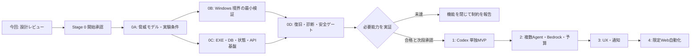

# Asteriade 段階的実装計画

作成日: 2026-10-20（Asia/Tokyo）  
状態: Stage 0 開始承認済み。Stage 0 の基盤を実装中。Stage 1〜4 は未着手・未承認。

## 1. 基準と実装開始の条件

2026-10-20 のユーザー承認により、既存 v1.1 を内容同一で [正式要件](REQUIREMENTS.md) に配置し、Stage 0 を開始した。Windows 実機検証はユーザーの手元で後から行う。Linuxで可能な基盤実装・検証を進め、必要能力が未実証のRunnerは閉じる。Stage 1以降は前Stageの結果と別途承認を要する。最新結果は [STAGE0_STATUS.md](STAGE0_STATUS.md)、実機手順は [WINDOWS_VALIDATION.md](WINDOWS_VALIDATION.md) を参照。

基本方針は、Windows 11 の単一 `asteriade.exe`、Go、埋め込み静的 UI、SQLite WAL、Control Plane/Orchestrator/Runner 分離である。最初に実効安全境界を検証し、自律実行の便利さを理由に順序を逆転しない。Kiro の自動連携、EC2/モバイルの実装、外部公開はこの計画の初期実装範囲に含めない。

## 2. 全体の依存とゲート

矢印は安全性と機能の依存を示す。各 Stage の終了は次 Stage の開始許可ではない。Stage 0 の基盤を限定モードで動かせても、必要能力が未実証なら Stage 1 の自律実行ゲートは未達である。接続確認やドキュメント作業など独立した進捗と、開放できる能力を分けて報告する。

| Stage | 成果 | 主なゲート | 次段階まで閉じる機能 |
|---|---|---|---|
| 0 | 起動・保存・状態・停止復旧・権限・診断の基盤 | Windows 実機で必須の肯定/否定テスト、構成別の能力判定 | 無人 Codex ツール実行、複数Agent、従量API、Web操作 |
| 1 | Codex だけで小規模開発を端から端まで実行する MVP | 実タスクの成果物とテスト、権限制約、計画確認・停止・追加指示 | Bedrock、再帰Agent、永続Web許可 |
| 2 | 複数Agent、隔離Workspace、Bedrock、費用管理 | 混線・上限逸脱なし、適格性と原子的予算予約 | 任意Web自動化、未確認Provider |
| 3 | 日常操作の UI、検索、成果物、Windows通知 | 通常操作の完結、通知対象と遷移・重複排除 | 未承認Web操作、遠隔公開 |
| 4 | 専用Edge、限定Web操作、期限付き許可 | 対象外拒否、送信承認、悪意ある入力で境界を越えない | Kiro自動連携、リモート配置等は別計画 |

## 3. Stage 0 — 基盤と実効安全境界

### 0A. 実験条件と契約を固定する

着手条件は Stage 0 の承認、正式要件の確認、Windows 11 の試験先確保。対象 build/edition、Go/Codex の版、利用可能な認証、禁止操作、保護対象、Task 上限・時計の意味を確認する。必要な管理者設定やアカウント作成を洗い出し、具体的な変更が必要になった時点で別途許可を得る。

成果物は脅威モデル、実験プロファイル、採用候補と不採用理由、契約テスト仕様。初期構成案は Control Plane/Orchestrator を同一 Go プロセス、Runner を同じ EXE の別プロセスとし、OS 制約の成否で採否を決める。Job Object 単体や通常ユーザーの Restricted Token だけで安全と結論しない。

### 0B. Windows の最小境界を先に実証する

[検証計画](SECURITY_VALIDATION.md) SEC-01〜08 の fixture を専用領域に作る。最初はモデルを介さないテスト payload、次に公式 Codex の実際の子孫経路で同じ境界を確認する。課金なしで可能なプロトコル/起動/拒否試験を優先し、実認証やモデル実行が必要なら既存利用権と料金を確認する。別途課金 API を無断使用しない。

重点は、Workspace 外/他 Task/管理 DB/秘密へのアクセス、子孫・Job離脱・起動競合、直接通信・proxy・loopback、Host と Worker の資格情報/通信分離、Named Pipe の実効認証である。必要な runtime 読取り例外は明示する。拒否試験だけでなく、Workspace 内の許可操作と許可された Host 通信が動く陽性対照も実施する。

Codex の `readiness=ready`、モデル一覧掲載、承認画面の表示は動作・権限制約の証拠にしない。両立しない場合は U-03/U-04 として原因と代替を記録し、該当する自律能力を無効化する。

### 0C. 最小の実行可能基盤を作る

0B と独立する範囲は並行してよいが、結果未達の能力は開けない。

1. Windows x64 単一 EXE、埋め込み静的 UI、独立したユーザーデータ領域、loopback 限定の管理 API。
2. Storage interface、SQLite driver 選定、マイグレーション、外部キー・status制約、WAL、容量不足とバックアップ/復元。
3. Project/Agent/Plan/Phase/Task/Execution/Session の ID、許可遷移、scheduler 停止、claim/枠/epoch、理由付き時間区間。
4. 基本的な認証/Host/Origin/CSRF、承認対象 hash と失効、secret の参照分離。
5. 状態更新と events/outbox の原子性、重複request/配送の排除、外部成否不明の journal と復旧骨格。
6. 診断画面。Codex は診断対象、Bedrock は未実装/未設定、Kiro は未対応理由を表示し、全 Provider の設定を強制しない。

DB 全将来テーブルや全機能を先行実装しない。fake Provider/Runner は状態・異常系の自動テスト用に使い、実Windows/実Codex経路の安全性を証明したと報告しない。テスト用の外部操作はダミーsinkを使い、本番への送信は行わない。

### 0D. 停止、復旧、診断と終了判定

SEC-09/10/15/16/19 を含め、起動→保存→終了→再起動、claim競合、強制終了、送信直後切断、期限超過、二重起動、DB破損/ディスク不足、バックアップ復元を確認する。起動時の不確定実行を即成功・即再実行しない。復旧に使った照会結果を監査に残す。

**Stage 0 の必須ゲート**

- Node/npm/Docker/外部DBのない対象Windowsで EXE と管理UIが起動し、状態が保持される。
- API と IPC に未認証/別Origin/Workerからの迂回が通らず、管理側データが分離される。
- 必要な禁止操作が製品の実経路で拒否され、陽性対照も通る。構成と証跡が能力に束縛される。
- 停止・復旧・承認・状態/イベントの整合が保たれ、成否不明の送信を再実行しない。
- 未達は blocked/failed/unrun と記録し、機能を閉じる。限定モードの基盤成果と自律実行可能の判定を分ける。

引継ぎには実行可能なビルド、対象構成、試験件数と証跡、利用可能/無効能力、採用したdriver/版、既知制約、Stage 1へ進めるかを含める。必要な能力が未達なら Stage 1 の小規模開発MVPは開始/完了しない。

## 4. Stage 1 — Codex 単独の実用 MVP

着手には Stage 0 の必要能力合格、公式認証/利用条件確認、Stage 1 開始の承認を要する。1親Agent、同時実行1、Codex単独。要件の Phase・Task・Session の構造は保ち、再帰と従量Providerの先行導入はしない。

作るのは、チャットからの目標登録、計画と検証条件、計画確認モード、Codex実行、現在作業/進捗、基本承認、追加指示、停止/再開、成果物と最終結果。実行適格性の順序、資格情報保護、課金切替拒否、最低限の通知種別制限はこの段階から適用する。

**代表的な受入シナリオ**

管理下の小さなアプリfixtureに「入力の境界値検証を追加し、既存と追加のテストを通す」仕事を1件依頼する。事前に許可された差分範囲、具体的な入出力、実行すべき既存テストを acceptance spec に固定する。依頼→計画確認→実行→差分/テスト→Artifact→最終表示まで追跡する。Git push、公開、課金先変更は含めない。

合格には、指定動作の実測と実行したテストの件数/結果が必要。モデルの完了発言、syntax checkだけ、0件/全skipのテストでは代用しない。失敗fixture（成果物なし、テスト失敗、検証後差替え、悪意あるrepository指示）で Task/Project が completed にならないことも確認する。

SEC-07/09/10/13/14/17/19 と Stage 0 の関連境界を再実行し、追加指示の received→applied と計画改訂、pause/interrupt/cancel、auth失効/usage不明、計画4→5phase変更を確認する。Codex の interruption/approval 対応を推測で実装せず、固定版 schema と契約テストへ反映する。Stage 1 はこの端から端までの小規模開発がWindows上の制約内で通って初めてMVP合格とする。

## 5. Stage 2 — 複数 Agent、Bedrock、予算

着手には Stage 1 合格、Stage 2 承認、Bedrock のリージョン・モデル・単価・ツール/履歴制約・利用許可の確認を要する。従量APIの許可を計画承認から推定しない。最初に mock の予算/履歴異常系を検証し、実料金が発生する試験は対象・上限を別途合意する。

実装順は次のとおり。

1. 全体の並列枠、rootを含む深さ、Task総数、再試行/時間上限の強制。DAGの循環拒否とversion/epoch付きclaim。
2. Task別 Workspace、Session/Artifact の分離、同一ファイル競合と差分/テストを経た統合。自動上書きは不可。
3. 追加従量費用の月次台帳、保守的見積・原子的予約・精算・不確定額保持。月3,000円/80%警告の既定値とサービス側の制限を分ける。
4. Bedrock Adapter と Converse/ConverseStream 履歴・署名・tool loop。各tool要求はPolicyとRunnerを必ず通す。
5. 必要ツール/OS/権限/認証/モデル機能/予算の判定を先に行うルーティング。各UIモードは適格候補だけを並べ替える。

SEC-11/12 と共有境界を実施する。親Projectを3件、子孫Taskを多数投入し、全体枠、深さ、履歴/成果物混線防止を確認する。残額に対する同時予約、単価不明、費用計測欠落、切断後精算、重複event、月跨ぎで超過見込みの新規従量送信が止まることが必須。子からの質問は親へ集約し、ユーザーに通常の子完了通知を送らない。

同じモデルでも接続/Providerが異なればSession互換性を確認し、必要なら別Sessionに明示的な引継ぎを行う。モデル切替を理由にTaskIDや結果を消さない。Kiroの自動実行は追加しない。

## 6. Stage 3 — 日常利用の UX と通知

着手には Stage 2 合格と承認を要する。親Projectの簡潔な一覧、展開式Phase/Task、要対応件数、フィルター/検索、変更差分・成果物・検証結果・未解決への導線、承認詳細、料金/利用量を整える。色だけに状態を依存させず、基本操作は管理UIで完結させる。

Windows通知の登録方式は対象環境で検証し、未対応ならアプリ内通知へ縮退する。SEC-17 と成果物previewのSEC-14/管理APIのSEC-08を確認する。子孫の大量完了/通常再試行/モデル切替ではユーザー通知0、最上位完了/親の質問/承認/予算/重大停止は重複を除き該当画面へ直接遷移することが合格条件。アプリ停止中の実配信は要件外で、再起動後の履歴表示を確認する。

スマホ向けのレスポンシブな表示は考慮するが、外部公開・PWA・Push配信・遠隔認証の実装はしない。

## 7. Stage 4 — 限定 Web 自動化と高度化

着手には Stage 3 合格と承認、専用Edgeプロファイル・サイト/操作の利用条件と境界確認を要する。最初の対象サイトと少数の操作を限定し、汎用「このサイトの全操作を許可」を作らない。

永続許可は origin（scheme/host/port）、service、account、操作種類、対象、条件、期限で限定し、暫定30日、失効/取消/監査を実装する。`今回のみ/このTask中/同種操作の期限付き許可/拒否` の違いを画面とデータに反映する。決済、送金、認証変更、本番デプロイ、大量削除は原則毎回承認で永続許可しない。

SEC-09/13 をWeb実経路で実施し、初回送信承認、許可条件の各要素変更、期限切れ、悪意あるページ、redirect、ファイルupload/download、成否不明送信で拒否/再承認になることを確認する。読み取りに見えるGETにも副作用があるため、モデルが「閲覧」と呼んだだけで自動許可しない。CAPTCHA/MFAは人へ引き継ぐ。

モデル実績に基づくルーティング改善は安全適格性判定の後段に置き、成功率で権限・費用条件を緩めない。KiroやEC2/スマホ実装は、この段階を理由に黙って追加せず別設計と承認へ送る。

## 8. 受入テストとの対応表

以下は受入目標の対応表。部分実装のLinux試験とWindows実機の最終合格を区別し、実施結果は STAGE0_STATUS.md に記録する。Stage欄は最初に導入する段階と再検証を示し、未実施の将来試験を合格件数へ含めない。

| AT | Stage | 設計箇所（ARCHITECTURE） | 必須の観測/否定条件 | 検証計画 |
|---|---|---|---|---|
| AT-01 | 0 | §2/4/7.1 | Windowsで単一EXE、runtime依存不要、loopback/データ分離 | SEC-16 |
| AT-02 | 0骨格/1実接続 | §3/7.2/8 | 未設定理由を表示、Codex単独可、未設定Providerへの実行不可 | SEC-07/16 |
| AT-03 | 0、実接続1 | §3/4/7.2 | 外側read/writeのOS拒否と内側の陽性対照 | SEC-02/03/07 |
| AT-04 | 0、実接続1 | §3/7.2 | 任意shell/通信/pushの迂回拒否、未達なら無人対象外 | SEC-04/05/07 |
| AT-05 | 1 | §5/7.3 | 代表開発タスクの計画→実行→検証→結果 | SEC-07/14 |
| AT-06 | 1 | §5.1/6.2/7.3 | 偽の完了/成果物なし/0件テストで完了にしない | SEC-14 |
| AT-07 | 1 | §5.1/6.2/7.1 | receivedを先に保存し適用先/改訂/安全区切りを表示 | SEC-19 |
| AT-08 | 0骨格/1 | §5.2/5.3 | 新規claim停止、中断/取消と終了確認の分離 | SEC-10/19 |
| AT-09 | 0、実接続1 | §5.3/6.4 | 強制終了後に復旧待ち、自動成功/再実行なし | SEC-10/15 |
| AT-10 | 1、切替2 | §7.2/8 | auth/枠失効を表示、無断従量切替なし | SEC-07/11 |
| AT-11 | 2 | §7.2/8 | tool非対応モデルは適格候補から除外 | SEC-11/12 |
| AT-12 | 2 | §6.3/8 | 見積超過/不明なら原子的予約不可で送信0 | SEC-11 |
| AT-13 | 2 | §5.3/6.2/8 | 3親と大量子孫、全体枠/深さ/混線防止 | SEC-12/19 |
| AT-14 | 2 | §4/6.2 | 競合を検出し保留、検証した差分のみ統合 | SEC-12 |
| AT-15 | 0骨格/1、Web4 | §6.3/6.4/7.3 | dispatch後切断はunknown、二重送信なし | SEC-10 |
| AT-16 | 1ローカル入力/4 Web | §3/7.2/8 | 悪意ある入力で秘密/外側/送信境界を越えない | SEC-06/13 |
| AT-17 | 0骨格/1、Web4 | §3/6.3/7.3 | 対象/内容/差分/費用の承認、差替え拒否 | SEC-09 |
| AT-18 | 4 | §6.3/8 | 条件一致だけ許可、期限/対象/アカウント変更で再承認 | SEC-09/13 |
| AT-19 | 1基本/2子孫/3 UX | §3/6.3/8 | 子孫/通常retryの通知0、内部eventあり | SEC-17 |
| AT-20 | 1基本/2料金/3 UX | §6.3/8 | 許可種別の親通知、対象画面へ遷移 | SEC-17 |
| AT-21 | 1基本/3 UX | §6.2/7.1/8 | 完了通知から成果物/差分/検証/未解決へ到達 | SEC-14/17 |
| AT-22 | 1 | §5.1/6.2/8 | 4→5phaseの版/進捗/改訂履歴の整合 | SEC-19 |
| AT-23 | 0 | §6.4 | DB破損/容量不足を成功にせず原本保全/復旧 | SEC-15 |
| AT-24 | 0骨格/1実接続/2 | §5.3/6.4/7.2 | 通信/auth/応答異常で安全遷移、無限retryなし | SEC-07/10/11 |
| AT-25 | 0 | §7.1 | 別Origin/CSRF/不正Hostの操作拒否 | SEC-08 |
| AT-26 | 初期は設計のみ | §7.2/9 | 通信断を成功扱いせず最終同期/再同期契約 | SEC-18 |

要件 §3–10/14 の共通基盤は Stage 0/1、§11–12 の基本導線は1・完成度改善は3、§13 は4、§15 は初期のinterface設計だけに対応する。AT-26 は未実装のリモート試験を実行済みと扱わない。AT-19/20 の対象制限はStage 3まで延期せず、通知機構の最初から適用する。

## 9. テスト運用、証跡、ハンドオフ

実装後の検証コマンドは採用した toolchain とコード配置に合わせて確定する。候補は `go test ./...`、Windows向けビルド、Windows実機の統合/禁止操作試験、ブラウザの同一Origin/CSRF試験。設計時点にはコードはなかったが、Stage 0でGo/SQLite基盤を導入した。現在の実行コマンドと結果はREADMEおよびSTAGE0_STATUS.mdを参照する。UIのビルドツールは必要が出た段階で選び、Nodeを実行時の必須にしない。

各 Stage は実行対象・版・入力・期待/観測・exit status・テスト件数と結果ファイルを保存する。passed/failed/blocked/skipped/unrunを分け、0件や全skipを readiness の根拠にしない。mock、Linux、Windows、実Provider、設計レビューの証拠を区別する。必要チェックが通ったら関連のない suite へ範囲を広げない。

各 Stage の終了時は、変更ファイル、実行可能ビルド、実行試験と件数、失敗の原因、利用可能/無効な能力、既知制約、依存/認証/OS設定、次段階の範囲を報告し、承認前に進まない。サブエージェントは独立した調査・テスト設計・局所編集に使い、共有ファイルを競合編集させない。最終的な安全・アーキテクチャ・リリース判断は親が検証する。

## 10. Stage 0 開始前に確認する事項

1. **要件:** 解決済み。ユーザー承認によりv1.1を正式基準として `docs/REQUIREMENTS.md` へ内容同一で配置（U-01）。
2. **承認範囲:** Stage 0 限定で基盤コードとテストを作ること。Stage 1 の自律実行、commit/push、公開・デプロイ・課金先追加は含めない。
3. **実機:** Windows 11 build/edition、テスト用Workspace/ユーザー、管理者操作の可否。LinuxのみならWindows合格は保留。
4. **Codex:** 公式固定版、認証方式・利用条件、既存利用枠、ツール/秘密/通信の分離を検証する方法。必要な秘密はチャットに貼らず安全な設定経路を使う。
5. **初期値案:** root深さ1/全体並列3（Stage 1は1）/再試行2/Task総数100/Execution実働30分/Project実働合計2時間、月境界と待機・一時停止時の計上（U-02）。
6. **データ保護:** 秘密保管方式、履歴・成果物/バックアップの保持・暗号化・削除、初期APIセッション引渡し（U-06）。

U-01とStage 0実装開始は承認済み。それ以外は0Aで調査・候補を具体化してよいが、管理者設定、秘密投入、外部送信、費用発生、未検証能力の有効化を先行させない。基盤の実装成功をStage 0安全ゲートの合格やStage 1の承認とは扱わない。
